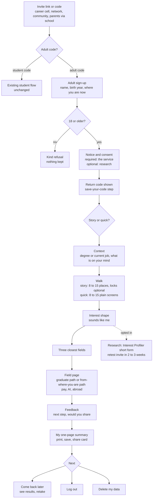
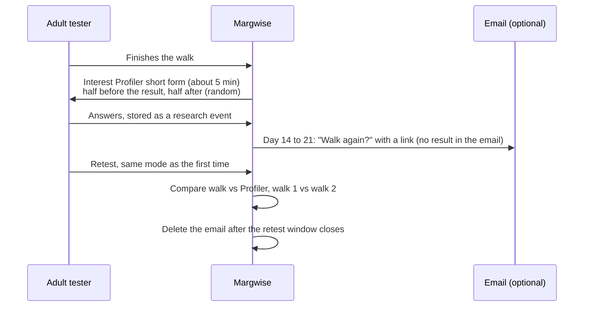

# Adult track: workflows from sign-in to the end

Status on 28 Oct 2026: design only. It builds on `docs/ADULT_TRACK.md` and reuses today's flow where it already works. Each step says whether it is **reused**, **changed** or **new**.

Today's flow, for reference: gate (name, invite code, a self-declared "18 or older, or my parent agrees" tick), then intro, context (class, board, stream lean), the walk with lamp locks, interest shape, the three closest fields, field page, parent summary, feedback, and log out. Return codes, saved progress and "Is this still <name>?" already exist.

## The whole journey

## 1. Arrival (changed)

| Entry | What the person gets | Track |
| --- | --- | --- |
| Career cell | A link with the code in it (`/?c=<code>`), from the coordinator, for final-year and postgraduate students only | Adult, graduate |
| Founder's network, online communities | A link with a per-channel code, so the source of each sign-up is known | Adult, either segment |
| Parents through schools | A parents-only link the school sends to parents, with a template message that says "for you, not for your child" | Adult, professional |
| Public adult link (later, after the lawyer's review) | An open sign-up with a site-wide daily cap | Adult |

- The invite code decides the track. An adult code can never create a student tester, and a student code never shows adult screens. This is set in `invites.track`, not in the page.
- The landing text for adult codes drops "Class 9 to 12" and "best with a parent beside you". It says what the person gets, how long it takes (about 15 minutes for the story, about 8 for quick mode), and that nothing is marked.
- A code in the link fills the code box. A person without a code sees "This test is by invitation for now".

## 2. Sign-up (changed)

Fields, in order. Nothing else is asked.

1. **Name or nickname.** As today. The hint changes to "So you can recognise your own results. A nickname is fine."
2. **Birth year.** A picker, not free text. Under 18, the person sees: "This version is for people 18 and over. Thank you for your interest." Nothing is stored, apart from the existing anonymous rate-limit row. The server works out an age band and keeps only that band (18 to 24, 25 to 34, 35 to 44, 45+), never the year. The check runs on the server, so editing the page does not get past it.
3. **Where are you now?** One choice. It picks which path section the person sees.
   - still in school (decision 3 below);
   - in college (final year or postgraduate);
   - graduated in the last three years;
   - working;
   - between jobs or on a break;
   - other.
4. **Notice.** A separate adult notice, in plain English, covering:
   - what is kept and why;
   - how long it is kept (the `RETENTION_DAYS` date, written as a date);
   - that nothing is sold or shared;
   - how to delete;
   - whom to complain to.
5. **Consent ticks.**
   - **Required:** "I am 18 or older and I agree to the notice above."
   - **Optional, unticked by default:** "I am happy to help research: one extra 5-minute questionnaire and an invite to walk again in 2 to 3 weeks."
6. **If research is ticked:** an optional email field, only for the retest invite (decision 1).

The server then claims the invite atomically (reused) and creates the tester with `track`, `age_band`, `stage`, `research_ok` and `consent_on`. It returns the token and the return code (reused).

**Save-your-code step (reused, changed wording).** "This code is the only way back to your results on another device. We do not have your phone number, so we cannot send it again." Offer copy, download as a small text file, and screenshot.

## 3. Coming back (reused)

| Situation | What happens |
| --- | --- |
| Same device, within 31 days | Straight to the welcome screen: "See my results", "Walk again", "Continue your walk" |
| New device, or the token has expired | "I have been here before" asks for the return code, which gives a fresh token |
| Shared device, idle for more than 2 hours | "Is this still <name>?" before anything is shown |
| Code lost | No recovery (no phone or email for login). Start again as a new person. The cautious repeat sign-up merge can link them if the name and invite match |
| Admin revoke | All tokens and the return code stop working |

## 4. Choosing a mode (new)

Two cards, shown once before the walk:

- **The Night of Lamps.** A story walk with pictures, about 15 minutes.
- **Quick mode.** The same choices in plain words, about 8 minutes.

Rules:

- The choice is recorded in every event as `mode` (`walk-story` or `walk-quick`).
- No switching mid-walk. The two are separate instrument versions, and a mixed walk cannot be scored as either. "Walk again" can use the other mode, and the result screen says which mode each result came from.
- The order of the two cards is randomised per person, so screen position does not decide the split.

## 5. Context (changed)

This replaces class, board and stream lean for adult testers. Every question can be skipped.

| Stage | Questions |
| --- | --- |
| In college or graduated | Your degree: a broad field from a short list (engineering, science, commerce, arts and humanities, law, medicine and health, design, other). What is on your mind: further study, a first job, studying abroad, not sure yet |
| Working or between jobs | Your current job: search the existing career list (gives a SOC code), or "not listed" with a broad group. Years of work: under 3, 3 to 7, 8 to 15, over 15. What is on your mind: a move in my field, a change of field, a skill to add, AI and my job, not sure yet |
| Still in school (if allowed) | Today's class, board and stream questions |

The answers only choose which path content is shown and in what order. They never change the interest profile or the field ranking, as with class and board today.

## 6. The walk (reused, with changes)

- **Story mode.** Today's walk unchanged in scored text. Adult wording only in the intro panels and in Ila's lines that mention school. Lamp locks become optional: "Want a short puzzle? (skip any time)". They were written and weighted for school students, and `APT_NUDGE` stays off for adults.
- **Quick mode (new).** One screen per place, with the four activity cards in neutral wording and the same two-flask spend. A progress bar replaces the road. No art, no locks, no story beats. The same adaptive length (8 to 15 places) and the same engine.
- **Both modes.** A `progress` event after every place (reused), so the walk can continue on any device. An idle person returns to "Continue your walk".
- **Abandoning.** A walk left unfinished for 7 days still counts toward completion figures (it is not quietly dropped). On return, the person is offered "continue" or "start over".

## 7. Results (changed)

1. **Interest shape (reused).** The cautious, broad and no-signal notes stay, and these must hold for adults too. Then "Does this sound like you?" on a 1 to 5 scale (reused), and optional self-ratings per area (reused).
2. **Three closest fields (reused).** The text says "areas to explore", never "your career".
3. **Field page (changed).** The path block depends on the stage:
   - **College or graduated:** the `after_degree` path. Master's routes and their exams, first jobs, certifications, a plan B, and the master's-abroad route first.
   - **Working or between jobs:** the from-where-you-are path. How close the field is to the current job, the skills to build, the AI exposure of the current job next to the target, and reskilling routes. Phase 3 only. Until then these users see the graduate path with a note that a working-life version is coming.
   - **Still in school (if allowed):** today's school path.

   Careers, US and India pay, AI exposure and the "check before relying on this" box are reused for every stage.
4. **My one-page summary (changed from "Summary for parents").** The same printable page, written for the person: their shape, three fields, the next step they wrote, the return code and the mode. A "share with someone who helps you decide" line replaces the parent framing.
5. **Share card (reused).** It shows the shape and the three fields, never the name.

## 8. Feedback (changed)

Ask at the right moment, not straight after the shape:

- **After the first field page is closed:** a small sheet with "One thing you will do next" (free text, required to submit, skip allowed) and "Would you send this to a friend?" (yes, no, maybe).
- **On "Log out" or leaving the results, once only:** today's ratings (looks, clear, fun, puzzles, the last only if puzzles were played), plus "Which mode did you use, and would you pick it again?".
- All of this goes into the existing `feedback` event, extended with `next`, `share`, `mode` and `again`. Free text stays capped at 1,500 characters.

## 9. Research, for people who opted in (new)

- The order is random: the Profiler goes before the result for half the testers and after it for the other half. This stops seeing the result first from shaping the Profiler answers.
- The retest uses the same mode as the first walk, or it tests nothing.
- The research consent can be withdrawn on its own at any time, from the results page footer. Withdrawing deletes the research data and the email, and keeps the person's walk and results.
- The analysis follows CALIBRATION.md steps 2 and 3, with intervals and with thresholds frozen before looking.

## 10. Leaving and deletion (changed and new)

| Action | What happens |
| --- | --- |
| Log out (reused) | Clears the device; data stays on the server until the retention date |
| See what you keep (new) | A plain list of what is stored for this person, from the server: age band, stage, mode, answers, results, feedback, research yes or no, email yes or no. A download as JSON |
| Delete my data (new) | Confirm twice, then the server deletes the tester row, every event, research data and email, and revokes all tokens. An audit row records "self-deleted" and the date, with no identity. The screen confirms, and that is the end |
| Retention (built, switched on) | Automatic purge after `RETENTION_DAYS`, with the date shown in the notice and on the summary |

## 11. Operator workflows

**Create an adult invite (changed).** Admin, then Invites, then New. Set:

- the track (adult), and the stage hint (graduate or professional), which only orders the stage list;
- a label (for example `cc-xyz-college-2026`);
- a use limit and an expiry.

The admin gets the link and a short message template for that channel.

**Career cell coordinator (new, deliberately small).** The college is not the user's guardian, so it does not see named adult results by default (decision 2). The coordinator page shows, for their codes only:

- sign-ups, completions and median time;
- the mode split;
- the top fields as counts;
- "sounds like me" as averages.

Each figure appears only from five people up, as the counsellor page already does.

**Parents through schools (new).** The school receives a parents-only code and the message template. It sees the number of sign-ups only, from five up.

**Monitoring (changed).** The admin page gains a per-track view, split by source, mode, stage and age band. It shows the decision-rule numbers from ADULT_TRACK.md:

- completion;
- median time by mode;
- "sounds like me" 4 or 5;
- the share of people who wrote a next step;
- the share of people who would send it to a friend.

**Possible minor (new).** If anyone reports an account that belongs to someone under 18, the admin deletes it at once, with an audit row. An invite code with an unusual number of under-18 refusals is paused and its channel checked. The refusals are counted per code, with no personal data.

**Requests and complaints (new).** A grievance address on every adult page. Requests to see, correct or delete data get an answer within the time the DPDP Rules set. The admin's delete is the same action as the self-service one.

**Breach (new).** A written runbook in PILOT_RUNBOOK.md: who decides, how to stop it, and how to tell the Data Protection Board and the affected people. Most testers have no email, so notice goes on the sign-in page.

**Content release (reused).** The `after_degree` and reskilling text goes through the existing shuffled fact-check and `--accept`. No unreviewed path text reaches adult testers.

## 12. Data changes

- `testers`: add `track`, `age_band`, `stage`, `research_ok`, `research_email` (nullable, deleted after the retest window), `deleted_self` (audit only).
- `invites`: add `track` and `stage_hint`.
- `events`:
  - add `mode` to `context`, `progress`, `result` and `snapshot`;
  - add the new adult `context` fields;
  - extend `feedback`;
  - add a new `research` event type, for the Profiler answers.
- New endpoints:
  - `POST /api/me/export` (see what you keep);
  - `POST /api/me/delete`;
  - `POST /api/me/research` (opt out);
  - a coordinator view inside `review.js`, scoped by invite code.
- One migration file (`schema13.sql`). Every new column is nullable, so student testers are untouched.

## Decisions needed before building

1. **Email for research.** Optional email only for the retest invite, deleted afterwards (recommended)? Or no email at all, with coordinators sending the retest reminder?
2. **Career cells and individual results.** Aggregates only (recommended)? Or a per-person "share my result with my career cell" opt-in?
3. **18-year-olds still in school.** Should an adult who says "still in school" see today's school path? That is legal for an 18-year-old and the content fits, but it invites 17-year-olds to lie about their year. The recommendation is yes, never promoted, with the refusal rule unchanged.
4. **Lamp locks for adults.** Optional in story mode (recommended), or removed for adults?
