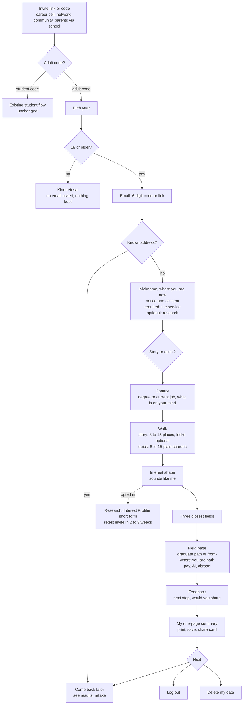
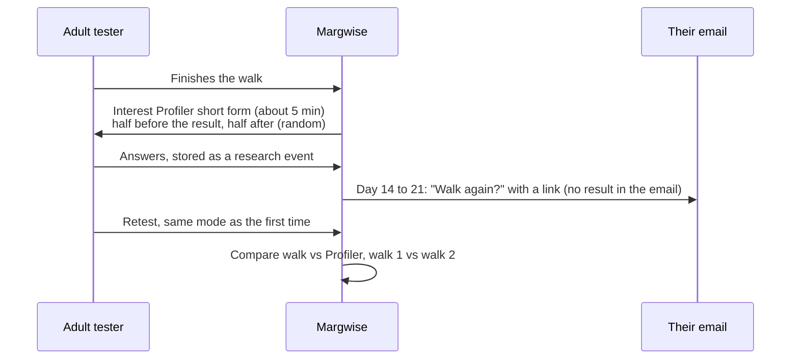

# Adult track: workflows from sign-in to the end

> **Changed 28 Oct 2026.** For working adults, the result is the career graph view in `docs/CAREER_GRAPH.md` ("What a working adult sees"). The walk (sections 4 and 6) is an optional lens taken before or after it, not the first step. Sign-in, consent, research, deletion and operator workflows below still apply.

Status on 28 Oct 2026: design only. It builds on `docs/ADULT_TRACK.md` and reuses today's flow where it already works. Each step says whether it is **reused**, **changed** or **new**.

Today's flow, for reference: gate (name, invite code, a self-declared "18 or older, or my parent agrees" tick), then intro, context (class, board, stream lean), the walk with lamp locks, interest shape, the three closest fields, field page, parent summary, feedback, and log out. Return codes (replaced by verified email for adults), saved progress and "Is this still <name>?" already exist.

## The whole journey

## 1. Arrival (changed)

| Entry | What the person gets | Track |
| --- | --- | --- |
| Career cell | A link with the code in it (`/?c=<code>`), from the coordinator, for final-year and postgraduate students only | Adult, graduate |
| Founder's network, online communities | A link with a per-channel code, so the source of each sign-up is known | Adult, either segment |
| Parents through schools | A parents-only link the school sends to parents, with a template message that says "for you, not for your child" | Adult, professional |
| Public adult link (later, after the lawyer's review) | An open sign-up with a site-wide daily cap | Adult |

- The invite code decides the track. An adult code can never create a student tester, and a student code never shows adult screens. This is set in `invites.track`, not in the page.
- The landing text for adult codes drops "Class 9 to 12" and "best with a parent beside you". It says what the person gets, how long it takes (about 15 minutes for the story, about 8 for quick mode), and that nothing is marked.
- A code in the link fills the code box. A person without a code sees "This test is by invitation for now".

## 2. Sign-up with a verified email (new)

The email is the account. It replaces return codes for adults: it is how people log in on any device, recover access, and get the retest invite if they opted in. The invite code still decides the track and the channel while the test is by invitation.

Steps, in order. The order is chosen so that nothing personal is collected from someone who will be refused.

1. **Birth year first.** A picker, not free text, asked before the email.
   - Under 18 sees: "This version is for people 18 and over. Thank you for your interest." No email is asked for and nothing is stored, apart from the existing anonymous rate-limit row and a per-code refusal count.
   - The server works out an age band and keeps only that band (18 to 24, 25 to 34, 35 to 44, 45+), never the year.
   - The check runs on the server, so editing the page does not get past it.
2. **Email.** The server sends one email holding both a 6-digit code and a sign-in link, valid for 15 minutes. Both are offered because a link opened inside a mail app often lands in a different browser and loses the walk; the code works anywhere.
   - Limits: 3 emails per address per hour, the existing per-connection limit, and a site-wide daily cap. A wrong code 5 times voids it.
   - The screen always says "If this address can sign in, we have sent a code", so nobody can test which addresses are registered.
   - Throwaway-address domains are refused, with a short list kept in config.
3. **Verify.** On success:
   - **A new address** goes on to step 4.
   - **A known address** signs in to the existing account (section 3). This replaces the cautious merging of repeat sign-ups for adults: one email is one person.
4. **Name or nickname.** "So you recognise your own results. A nickname is fine."
5. **Where are you now?** One choice. It picks which path section the person sees.
   - still in school (shows today's school path);
   - in college (final year or postgraduate);
   - graduated in the last three years;
   - working;
   - between jobs or on a break;
   - other.
6. **Notice.** A separate adult notice, in plain English, covering:
   - what is kept and why, now including the email address;
   - how long it is kept (the `RETENTION_DAYS` date, written as a date);
   - that nothing is sold or shared, and that we email only sign-in codes plus, if they opt in, one retest invite;
   - how to delete;
   - whom to complain to.
7. **Consent ticks.**
   - **Required:** "I am 18 or older and I agree to the notice above."
   - **Optional, unticked by default:** "I am happy to help research: one extra 5-minute questionnaire and one email inviting me to walk again in 2 to 3 weeks."

The server then claims the invite atomically (reused) and creates the tester with `email`, `track`, `age_band`, `stage`, `research_ok` and `consent_on`. It returns a token (reused). No return code is shown to adults.

**What email does not do.** It proves the person owns an inbox, not their age. The birth-year check, not promoting the track in schools, and deleting any minor's account found later remain the age controls.

**Email sending.** Cloudflare Email Service from a `byteheaven.in` address, with SPF, DKIM and DMARC set, so it stays on the existing platform. Transactional email only: no newsletters or marketing without a separate, later consent.

## 3. Coming back (changed)

| Situation | What happens |
| --- | --- |
| Same device, within 31 days | Straight to the welcome screen: "See my results", "Walk again", "Continue your walk" |
| New device, or the token has expired | "Log in": the email, then the 6-digit code or the link. A fresh token |
| Shared device, idle for more than 2 hours | "Is this still <name>?" before anything is shown |
| No longer has the inbox | Cannot sign in. They can ask the grievance contact, who deletes the old account on request. They then sign up again with a new address |
| Wants to change email | Not in the first version. Delete and sign up again, or ask the grievance contact |
| Log out everywhere (new) | A button that ends every session for the account (the existing revoke, now self-service) |
| Admin revoke | All tokens stop working |

## 4. Choosing a mode (new)

Two cards, shown once before the walk:

- **The Night of Lamps.** A story walk with pictures, about 15 minutes.
- **Quick mode.** The same choices in plain words, about 8 minutes.

Rules:

- For working or between-jobs testers, quick mode is pre-selected and the story is one tap away. For everyone else neither is pre-selected.
- The choice is recorded in every event as `mode` (`walk-story` or `walk-quick`).
- No switching mid-walk. The two are separate instrument versions, and a mixed walk cannot be scored as either. "Walk again" can use the other mode, and the result screen says which mode each result came from.
- The order of the two cards is randomised per person, so screen position does not decide the split.

## 5. Context (changed)

This replaces class, board and stream lean for adult testers. Every question can be skipped.

| Stage | Questions |
| --- | --- |
| In college or graduated | Your degree: a broad field from a short list (engineering, science, commerce, arts and humanities, law, medicine and health, design, other). What is on your mind: further study, a first job, studying abroad, not sure yet |
| Working or between jobs | Your current job: search the existing career list (gives a SOC code), or "not listed" with a broad group. Years of work: under 3, 3 to 7, 8 to 15, over 15. What is on your mind: a move in my field, a change of field, a skill to add, AI and my job, not sure yet |
| Still in school | Today's class, board and stream questions |

The answers only choose which path content is shown and in what order. They never change the interest profile or the field ranking, as with class and board today.

## 6. The walk (reused, with changes)

- **Story mode.** Today's walk unchanged in scored text. Adult wording only in the intro panels and in Ila's lines that mention school. Lamp locks become optional: "Want a short puzzle? (skip any time)". They were written and weighted for school students, and `APT_NUDGE` stays off for adults.
- **Story for working adults (changed framing, same scored text).** The story's theme suits career changers: the lamplighter "tried many kinds of work so that you could find yours", and the note ends "The road was never mine. Choose yours." What does not suit them:
  - the art shows a teenager (intro panel 3), so redraw it as an adult;
  - Ila calls the lamplighter "my teacher", so make her a former colleague who worked beside her;
  - lines aimed at children, such as "Best with a parent beside you", go.

  The cards stay as they are. Their trade-offs ("face the blame if it goes wrong", "with an hour to finish") already read like work. Check the result with five people from the founder's network before the first invites: do they find it childish, and do they finish it?
- **Quick mode (new).** One screen per place, with the four activity cards in neutral wording and the same two-flask spend. A progress bar replaces the road. No art, no locks, no story beats. The same adaptive length (8 to 15 places) and the same engine.
- **Both modes.** A `progress` event after every place (reused), so the walk can continue on any device. An idle person returns to "Continue your walk".
- **Abandoning.** A walk left unfinished for 7 days still counts toward completion figures (it is not quietly dropped). On return, the person is offered "continue" or "start over".

## 7. Results (changed)

1. **Interest shape (reused).** The cautious, broad and no-signal notes stay, and these must hold for adults too. Then "Does this sound like you?" on a 1 to 5 scale (reused), and optional self-ratings per area (reused).
2. **Three closest fields (reused).** The text says "areas to explore", never "your career".
3. **Field page (changed).** The path block depends on the stage:
   - **College or graduated:** the `after_degree` path. Master's routes and their exams, first jobs, certifications, a plan B, and the master's-abroad route first.
   - **Working or between jobs:** the from-where-you-are path. How close the field is to the current job, the skills to build, the AI exposure of the current job next to the target, and reskilling routes. Built first. Graduates' `after_degree` path comes later; until then graduates see the professional path with a note.
   - **Still in school:** today's school path.

   Careers, US and India pay, AI exposure and the "check before relying on this" box are reused for every stage.
4. **My one-page summary (changed from "Summary for parents").** The same printable page, written for the person: their shape, three fields, the next step they wrote and the mode. It no longer prints a return code. A "share with someone who helps you decide" line replaces the parent framing.
5. **Share card (reused).** It shows the shape and the three fields, never the name.

## 8. Feedback (changed)

Ask at the right moment, not straight after the shape:

- **After the first field page is closed:** a small sheet with "One thing you will do next" (free text, required to submit, skip allowed) and "Would you send this to a friend?" (yes, no, maybe).
- **On "Log out" or leaving the results, once only:** today's ratings (looks, clear, fun, puzzles, the last only if puzzles were played), plus "Which mode did you use, and would you pick it again?".
- All of this goes into the existing `feedback` event, extended with `next`, `share`, `mode` and `again`. Free text stays capped at 1,500 characters.

## 9. Research, for people who opted in (new)

- **Why retest at all.** It checks whether the same person gets the same result 2 to 3 weeks later. Without it the product works, but it can never claim the result is stable (CALIBRATION.md: "interest snapshot with known reliability" needs steps 1 to 3 to pass). About 50 retests are enough for a first estimate.
- The order is random: the Profiler goes before the result for half the testers and after it for the other half. This stops seeing the result first from shaping the Profiler answers.
- The retest uses the same mode as the first walk, or it tests nothing.
- The research consent can be withdrawn on its own at any time, from the results page footer. Withdrawing deletes the research data and stops the retest email, and keeps the person's walk and results.
- The analysis follows CALIBRATION.md steps 2 and 3, with intervals and with thresholds frozen before looking.

## 10. Leaving and deletion (changed and new)

| Action | What happens |
| --- | --- |
| Log out (reused) | Clears the device; data stays on the server until the retention date |
| See what you keep (new) | A plain list of what is stored for this person, from the server: age band, stage, mode, answers, results, feedback, research yes or no, and the email address. A download as JSON |
| Delete my data (new) | Confirm twice, then the server deletes the tester row, every event, research data and email, and revokes all tokens. An audit row records "self-deleted" and the date, with no identity. The screen confirms, and that is the end |
| Retention (built, switched on) | Automatic purge after `RETENTION_DAYS`, with the date shown in the notice and on the summary |

## 11. Operator workflows

**Create an adult invite (changed).** Admin, then Invites, then New. Set:

- the track (adult), and the stage hint (graduate or professional), which only orders the stage list;
- a label (for example `cc-xyz-college-2026`);
- a use limit and an expiry.

The admin gets the link and a short message template for that channel.

**Career cell coordinator (new, deliberately small).** The college is not the user's guardian, so it never sees named adult results (decided). The coordinator page shows, for their codes only:

- sign-ups, completions and median time;
- the mode split;
- the top fields as counts;
- "sounds like me" as averages.

Each figure appears only from five people up, as the counsellor page already does.

**Parents through schools (new).** The school receives a parents-only code and the message template. It sees the number of sign-ups only, from five up.

**Monitoring (changed).** The admin page gains a per-track view, split by source, mode, stage and age band. It shows the decision-rule numbers from ADULT_TRACK.md:

- completion;
- median time by mode;
- "sounds like me" 4 or 5;
- the share of people who wrote a next step;
- the share of people who would send it to a friend.

**Possible minor (new).** If anyone reports an account that belongs to someone under 18, the admin deletes it at once, with an audit row. An invite code with an unusual number of under-18 refusals is paused and its channel checked. The refusals are counted per code, with no personal data.

**Requests and complaints (new).** A grievance address on every adult page. Requests to see, correct or delete data get an answer within the time the DPDP Rules set. The admin's delete is the same action as the self-service one.

**Breach (new).** A written runbook in PILOT_RUNBOOK.md: who decides, how to stop it, and how to tell the Data Protection Board and the affected people. Adults are told by email and on the sign-in page; student testers, who have no email, on the sign-in page.

**Content release (reused).** The `after_degree` and reskilling text goes through the existing shuffled fact-check and `--accept`. No unreviewed path text reaches adult testers.

## 12. Data changes

- `testers`: add `email` (lower-cased), `email_hash` (HMAC, unique, used for look-ups and limits), `track`, `age_band`, `stage`, `research_ok`, `deleted_self` (audit only).
- New `email_codes` table: `email_hash`, `code_hash`, `expires_at`, `tries`. Rows are deleted on use or expiry, and nothing is kept in plain text.
- Admin and coordinator pages never show a full address: the admin sees a masked one (`a***@gmail.com`), and coordinators see none.
- `invites`: add `track` and `stage_hint`.
- `events`:
  - add `mode` to `context`, `progress`, `result` and `snapshot`;
  - add the new adult `context` fields;
  - extend `feedback`;
  - add a new `research` event type, for the Profiler answers.
- New endpoints:
  - `POST /api/email/start` and `POST /api/email/verify` (sign-up and log-in);
  - `POST /api/me/logout-all`;
  - `POST /api/me/export` (see what you keep);
  - `POST /api/me/delete`;
  - `POST /api/me/research` (opt out);
  - a coordinator view inside `review.js`, scoped by invite code.
- One migration file (`schema13.sql`). Every new column is nullable, so student testers are untouched.

## Decisions taken (28 Oct 2026)

1. **Sign-in.** Adults register and log in with a verified email. This replaces return codes for adults. The same address carries the retest invite for people who opted into research.
2. **Career cells.** Aggregates only, from five people up. The college never sees a named adult's result.
3. **18-year-olds still in school.** They see today's school path. It is never promoted, and the under-18 refusal is unchanged.
4. **Lamp locks.** Optional in story mode only, and they never affect the ranking.
