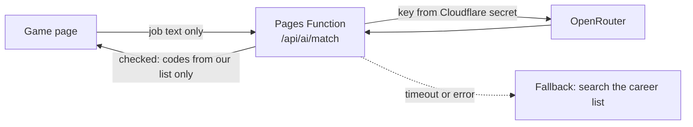

# AI layer: where a language model helps, and where it must not

Status on 28 Oct 2026: design only. Nothing below is built.

## The rule

The scoring engine stays as it is. A language model never scores, ranks or picks a field. Every fact a user sees still comes from the knowledge base, with its source, trust level and refresh date.

The model is used for three jobs only:

- understanding what a person types;
- reading changed official pages for a human reviewer;
- drafting text that a human checks before release.

Why it cannot be the engine:

| Need | The current engine | A language model |
| --- | --- | --- |
| The same answers give the same result | Yes, which is what makes test-retest and calibration possible | No. The output varies between runs and when a model version changes |
| Explainable ("How we got this result") | Every step can be shown and checked | No honest step-by-step account exists |
| Can be calibrated against an established inventory | Yes (CALIBRATION.md) | Not in any practical way |
| Cost and uptime | Runs in the page, free, never down | Free tiers are rate-limited, and free models are withdrawn without notice |

## "Latest information" comes from fetching, not from the model

A model knows only what it was trained on, up to a cutoff. Small free models state fees, exam dates and visa rules with confidence and are often wrong. That breaks the founding rule that facts are data with a source.

The latest information comes from re-reading the official pages, which `python3 pipeline/run.py --fetch` already does. The model's job is to read what changed and explain it to the reviewer. A human still approves every change through the fact check and `--accept`.

## Where AI fits, in build order

| # | Job | Where it runs | Risk | Why it is worth it |
| --- | --- | --- | --- | --- |
| 1 | **Job-title matching.** "SAP FICO consultant, 8 years" becomes the closest 3 careers from our own list (SOC codes), and the person confirms one | Live, at sign-up context (ADULT_WORKFLOWS section 5) | Low: the answer must be one of our codes, checked on the server; if it fails, the person searches the list | Professionals describe jobs in their own words. Without this, the from-where-you-are path starts from a wrong job |
| 2 | **Freshness watcher.** After each weekly `--fetch`, the model reads the old and new text of each changed official page and writes 2 or 3 lines for `CHANGES.md`: what changed and which facts it may affect | Offline, in the pipeline | Low: a human reads every note before anything changes | This is the safe way to get "latest info". It cuts review time instead of skipping review |
| 3 | **Drafting reskilling routes.** For each field and starting job group, a first draft of Indian reskilling routes: part-time degrees, certifications, lateral moves. Each statement must carry an official URL. Statements without one are thrown away | Offline, in the pipeline | Medium: drafts are often wrong. The existing shuffled fact-check catches them before release | The reskilling content is the most expensive part of the professional track. Drafting it with AI cuts writing time; checking time stays |
| 4 | **"Ask about my result" (later, maybe).** Questions about the person's own result, answered only from their result and the knowledge base, with a link to the source for every fact and a refusal for anything outside it | Live | High: hallucination, advice such as "quit your job", and prompt injection | Only after 1 to 3 work and the pilot shows people want it. Needs its own red-team pass |

Never: scoring or ranking, career advice beyond the knowledge base, anything a person could read as a verdict, or handling a name or email address.

## Provider

- **Zed.** Zed's AI is a feature of the Zed editor: its hosted models are for use inside the editor, and a key saved in Zed is the provider's key, used under that provider's terms. I found nothing that allows Zed's hosted models as a backend for another product. Do not plan on it.
- **OpenRouter (recommended).** One API key and one request format reach many models, so a withdrawn free model can be swapped with a config change. Free models (`:free`) currently allow about 20 requests a minute and 50 a day per account, or 1,000 a day once the account has bought at least US$10 of credit in total. Check these on openrouter.ai before relying on them; they change.
  - **Buy the US$10 once.** It moves the cap from 50 to 1,000 a day. 50 a day is fewer than one sign-up day for a small pilot.
  - **Privacy.** Free models are served by other companies, and some of them keep or train on prompts. Set the account's privacy settings, and send `provider: { data_collection: "deny" }` on every request, so only providers that do not keep data are used. If no free model meets that, use a cheap paid model for job 1: a job-title match is a few hundred tokens, a fraction of a rupee.
- **Model choice.** Pin one primary model and one fallback in config (`ai.models` in a new `data/ai_config.json`), not in code. Re-check both each month.

## How the key is kept and called

- **The key is a Cloudflare secret.** Set it with `npx wrangler pages secret put OPENROUTER_API_KEY --project-name margwise`. It never goes in the page, the repository or a URL. The pipeline (jobs 2 and 3) reads it from a local environment variable.
- **Only a Pages Function calls the model:** `hosting/functions/api/ai/match.js`. The page never talks to OpenRouter.
- **Limits.** The person must be signed in. Each person gets 10 AI calls a day, and the site gets a daily cap below the OpenRouter cap. Each call has a 6-second timeout, after which the page falls back to searching the list.
- **Minimum data.** Only the typed job text and the years-of-work band are sent: no name, email or results. The notice says so: "the job title you type is sent to an AI service to match it to our list".
- **Typed text is data, not instructions.** It goes in as a quoted field, the reply must match a JSON schema, and every code is checked against our career list on the server. Anything else is dropped.
- **Logs.** The model, tokens, time taken and success or failure are logged. Prompts and replies are not.
- **Kill switch.** An `AI_ENABLED` variable. With it off, everything works as it does today.

## Data protection

The AI provider becomes a processor of personal data. It may be outside India; DPDP allows that except to countries the government restricts. The adult notice must name the purpose and say that the data goes to an AI service.

Ask the lawyer from ADULT_TRACK.md about this in the same hour.

## Decision rules (frozen before data)

- **Job matching:**
  - the person accepts one of the 3 suggestions in at least 80 percent of cases;
  - at most 5 percent of accepted matches are judged wrong when the founder checks a sample of 50 against people they know;
  - median response time is 3 seconds or less.
- **Freshness watcher:** every change it flags is checked. Track how many were real changes, and how many real changes it missed when a reviewer spot-checks 10 pages a month.
- **Drafts:** record the share of drafted statements that pass the fact check. If it is under 50 percent, drafting costs more review time than it saves; stop.

## Build order

1. `ai_config.json`, the secret, the `/api/ai/match` function with limits, schema check and fallback, and the notice line. Tests use a fake model.
2. The job-title box in the professional context screen.
3. The freshness watcher in `pipeline/` (offline, no user data).
4. Reskilling drafts, through the existing fact check.
5. "Ask about my result": only if the pilot asks for it, and after its own review.
