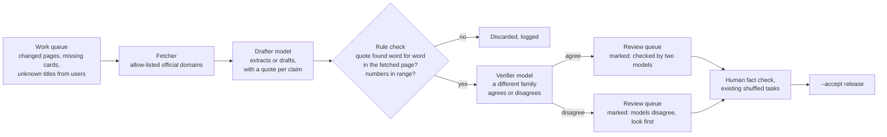

# AI layer: where a language model helps, and where it must not

Status on 28 Oct 2026: design only. Nothing below is built.

## The rule

The scoring engine stays as it is. A language model never scores, ranks or picks a field. Every fact a user sees comes from the knowledge base, with its source, trust level and refresh date. A model may help put a fact into the knowledge base. It never answers a user with a fact of its own.

Why a model cannot be the engine:

| Need | The current engine | A language model |
| --- | --- | --- |
| The same answers give the same result | Yes, which is what makes test-retest and calibration possible | No. The output varies between runs and when a model version changes |
| Explainable ("How we got this result") | Every step can be shown and checked | No honest step-by-step account exists |
| Can be calibrated against an established inventory | Yes (CALIBRATION.md) | Not in any practical way |
| Cost and uptime | Runs in the page, free, never down | Free tiers are rate-limited, and free models are withdrawn without notice |

## The key split: public data or personal data

Every AI job is either offline, working only on public pages, or live, touching something a user typed. The two have opposite needs, so they get different models, providers and rules.

| | **Offline (weekly pipeline)** | **Live (while a person uses the app)** |
| --- | --- | --- |
| Input | Official pages we fetched, and our own knowledge base. No personal data | Text a signed-in user typed |
| Speed needed | None: it can take an hour | Under 3 seconds |
| Free tiers that may train on prompts | Acceptable, because the input is already public | Not acceptable |
| Local model (LM Studio on the founder's PC) | Yes, when the PC is on | No: users cannot depend on a home PC |
| Web access | Yes, but only our own fetcher on allow-listed official domains | None. The live path never browses |
| Output goes to | A review queue, then a human, then a release | The user, only after rule checks, with a fallback |

## Layer 0: rules and data (always on, no AI)

This layer is what users rely on, and AI only feeds it.

- The engine, the knowledge base and the quality gate (`pipeline/validate.py`), as today.
- **Job-title dictionary (new).** `data/titles.json` maps typed job titles to SOC codes, for example "sap fico consultant" to 13-2011 and 15-1211. It is seeded from O*NET's alternate job titles (public, joined on SOC) and grows with every title a user confirms. A live lookup that hits the dictionary needs no AI at all.
- **Precomputed professional cards (new).** The from-where-you-are content is a static file keyed by starting job group and target field. It is computed and reviewed in the pipeline, so the page reads it like any other knowledge-base entry.

## Layer 1: offline AI in the weekly pipeline (the "counsel")

This is where your ideas fit: many switchable models, free tiers, the local model, web access and a counsel of experts. All of it is safe here, because no personal data is involved and a human reviews the output.

**Roles in the counsel.** Each role is a slot filled from config, not a hard-coded model:

- **Fetcher (no model).** Our own code reads only domains in `data/sources.yaml` and a new allowlist. Models never browse freely. A web page can carry hidden instructions, so the page text is passed to a model as data and the model is only asked to extract from it.
- **Drafter.** Writes the change note, the card text or the extracted fact. Every claim must carry an exact quote from the fetched page and that page's URL.
- **Rule check (no model).** This is the "rule-based checked model":
  - each quote must appear word for word in the stored page text;
  - every URL must be on the allowlist;
  - numbers must pass the existing ranges in `validate.py`;
  - the output must match the JSON schema.

  Anything that fails is thrown away. This step alone removes most hallucinations, because an invented fact has no real quote behind it.
- **Verifier.** A model from a different family reads the claim, the quote and the page, then answers "supported", "not supported" or "unclear". Different families make different mistakes, so agreement means more.
- **Human.** Nothing reaches users without the existing fact check. Two-model agreement only orders the review queue and speeds the human up. It never replaces the human. Once released, model-assisted facts take the existing trust levels (`official` when the quote is from the issuing body).

**Jobs for the counsel**, in build order:

1. **Freshness watcher.** For each official page that changed in the weekly `--fetch`, a 2 or 3 line note in `CHANGES.md`: what changed and which facts it may affect. This is how "latest info" arrives.
2. **Unknown job titles.** Titles users typed that missed the dictionary are suggested SOC codes. A human approves each suggestion, and it is added to `titles.json`.
3. **Professional cards.** Indian reskilling routes for each starting job group and target field (part-time degrees, certifications, lateral moves), each with a quote and a URL.
4. **Source discovery (rare, manual start).** A search step that proposes new official sources, for example a certification body's page. A human adds each one to `sources.yaml` before it is ever fetched.

**Where it runs.** On the founder's PC, weekly, so the local model can take a role. Alternatively in a GitHub Action with cloud models only. The pipeline works with any subset of providers.

## Layer 2: live AI (narrow, private, optional)

Only one live job at first: **matching a job title that missed the dictionary.**

1. The user types a title. The server looks in `titles.json` and needs no AI if it finds a match (most cases, over time).
2. On a miss, the server asks one model for the 3 closest codes from our list, sending only the title and the years-of-work band.
3. A rule check keeps only codes that exist in our list.
4. The user confirms one. The pair is logged as "unreviewed" and joins the offline queue. A confirmed pair joins the dictionary after review.
5. If there is an error, a timeout (6 seconds) or the budget is used up, the user searches the list. Nothing breaks.

"Ask about my result" stays a later, maybe-never idea (high risk). A safer kind of personal value comes from Layer 0, below.

## The "cache"

There is a cache, but it isn't a cache of model answers. Serving yesterday's unreviewed model answer to a new user would ship unchecked text. Instead:

- **Demand drives the work queue.** Each week the pipeline reads which (starting job, target field) pairs people reached, and which typed titles missed the dictionary. The most frequent gaps are filled first.
- **The answers are precomputed and reviewed.** The next person with the same starting job and field gets an instant, checked card from a static file. That is the fast path you described, and it gets faster and wider every week.
- **Coverage is measured.** A dashboard figure records the share of professional results that had a reviewed card. The target is 80 percent of results within 6 weeks of the first invites.

## Router and providers

Use one small router with ordered fallbacks, configured in `data/ai_config.json`. Do not run a separate gateway service.

| Option | Use it for | Notes |
| --- | --- | --- |
| **Gemini API, paid tier with a spend cap (₹500 a month, about US$6)** | Live job matching (Layer 2), and as a fallback in Layer 1 | Paid-tier prompts are not used to train models, and free-tier prompts are. AI Studio now has per-project spend caps, but the cap enforcement can lag by minutes, so also keep our own daily cap. A job-title match is a few hundred tokens, so ₹500 covers many thousands of matches |
| **OpenRouter free models** | Layer 1 drafter or verifier | About 50 requests a day, or 1,000 a day after a one-time US$10 credit purchase. Models rotate. Fine for public data |
| **OpenCode Zen free models** (not Zed) | Layer 1 extra counsel member | OpenCode's gateway is pay-per-use with some free models. It needs an account with billing details, and some free models say their data may be used for training. Fine for public data only. Check that its terms allow use by an app, not only by a coding agent |
| **LM Studio on the founder's PC** | Layer 1 verifier, or as a free drafter for short pages | Private and free, but only while the PC is on. Small models struggle with long pages, so send page sections, not whole sites |
| **Rules only** | Always the last fallback | Dictionary lookup and list search |

**Router choice.**

- **Offline, in Python:** LiteLLM (an open-source Python library) for fallback chains, retries and per-provider budgets. It fits the Python pipeline, and nothing new needs to be hosted.
- **Live:** about 50 lines inside the Pages Function. Two providers in order, a timeout, then rules.
- **OmniRoute:** an open-source TypeScript gateway that pools many free tiers. It is useful to know about, but it would be another service to host and secure, and its default chains fall through to free tiers that log prompts. That rules it out for anything live with user data. It could stand in for LiteLLM in Layer 1 later, if the free-tier pooling is worth it.
- **"Mimicking" OpenCode Zen:** there is no need. Zen is a gateway with an OpenAI-compatible API, so it becomes one more provider entry in the config.

## Keys and safety

- Keys live in Cloudflare secrets for the live path (`npx wrangler pages secret put GEMINI_API_KEY --project-name margwise`). For the pipeline they live in a local `.env`, which is git-ignored. They never go in the page or the repository.
- Live calls require a signed-in user. Each user gets 10 calls a day, and the site has a daily cap set below the spend cap.
- Only the typed title and the years-of-work band are sent: never a name, an email or results. The adult notice says the title is sent to an AI service.
- Text from users and from web pages is treated as data, never as instructions. Every model output must match a schema and pass the rule check.
- Logs record the model, tokens, time taken and success, never prompts.
- `AI_ENABLED=false` turns the live path off, and everything still works.
- The live provider is a processor of personal data and may be outside India. Ask the lawyer in the same hour as the other DPDP points.

## Personal value without a live model: "what changed for you"

The verified email makes a safe, useful feature possible. Users who opt in, with a separate tick (newsletters and updates need their own consent), get one email a month: "What changed for your fields". It is built entirely from reviewed knowledge-base changes that touch their three fields or their current job:

- an exam rule;
- a pay update;
- a new AI exposure release.

No model writes to the user and nothing is unchecked. It gives people a reason to come back, and a way to share it.

## Decision rules (frozen before data)

| Area | Rule |
| --- | --- |
| Job matching | At least 60 percent of lookups hit the dictionary within 4 weeks. The person accepts a suggestion at least 80 percent of the time. At most 5 percent of accepted matches are judged wrong in the founder's sample of 50 people they know. The median live time is 3 seconds or less |
| Counsel | Record the share of drafted claims that pass the quote check, the share the verifier agrees with, and the share the human accepts. If human acceptance is under 50 percent, drafting costs more review time than it saves; stop that job |
| Freshness watcher | Every flagged change is checked. A monthly spot check of 10 pages counts missed changes |
| Cost | Live spend stays under ₹500 a month. Offline spend is ₹0 while free tiers and the local model last |

## Build order

1. Seed `titles.json` from O*NET alternate titles. Add list search and dictionary lookup to the professional context screen. No AI yet.
2. `ai_config.json`, a LiteLLM router, the fetcher allowlist, the quote check, and the freshness watcher in `pipeline/`.
3. The live title match in `/api/ai/match`, with the Gemini paid tier, the caps and the fallback.
4. The demand-driven queue and the professional cards through the counsel and the fact check.
5. The monthly "what changed for you" email, with its own consent.
6. "Ask about my result": only if the pilot asks for it, and after its own red-team review.
