# Margwise architecture and data design

For reviewers. This describes what exists today, what is automated, and what is not. Where something is a plan, it says so.

## 1. What the system does

Margwise turns a story game ("The Night of Lamps") into a career-interest guide for Indian students in Class 9 to 12 and their parents. The player makes small choices; the game builds an interest profile (six RIASEC traits), ranks 16 career fields against it, and shows careers, school paths (CBSE, ICSE/ISC, state), India pay, how AI is changing each job, and an optional study-and-work-abroad view.

The product has two halves that are built to change at different speeds:

| Half | Changes | Lives in |
| --- | --- | --- |
| **The game** (story, interaction, scoring) | Rarely, and with a release | `app/` |
| **The knowledge base** (careers, exams, pay, AI exposure, abroad costs) | Constantly, because the world changes | `data/`, rebuilt by `pipeline/` |

The central design decision is that **facts are data with provenance, not text buried in code**, and that every change to them passes automated gates and a human review before a student can see it.

## 2. Design principles

1. **Provenance first.** Every external fact traces to an entry in `data/sources.yaml` (publisher, licence, trust level, refresh cadence, the script that reads it).
2. **Honest uncertainty.** Each figure carries a trust badge (official, secondary, estimate) that the UI shows. Estimates are labelled as ours.
3. **Gates, not goodwill.** `pipeline/validate.py` fails a build that breaks the data contracts. A broken build never reaches students.
4. **Humans decide, machines prepare.** Pipelines fetch, join, validate and diff. People review the change report and fact-check batches, then accept a release.
5. **Disjoint review.** Reviewers get one public fact and the official page to check it against. They never see the product, the scoring or the whole content set.
6. **Static by default.** The game ships its knowledge base inside the page, so it is fast on a poor network and cannot be broken by a database outage.
7. **Boring technology.** Python scripts, JSON files, Cloudflare Pages and D1. Nothing exotic to operate.
8. **Privacy by design.** Named testers only, an explicit notice of what is kept, per-person deletion, no phone, email or address collected.

## 3. System overview

```mermaid
flowchart LR
  subgraph Sources["Public sources (data/sources.yaml)"]
    O[O*NET interests, wages, tasks]
    A[Anthropic Economic Index + Eloundou 2023]
    P[PLFS India pay]
    X[Exam bodies, NIRF]
    B[Abroad: visas, fees, salaries, FX]
  end
  subgraph Pipeline["pipeline/run.py (offline or --fetch)"]
    S1[fetch + parse] --> S2[join onto career list]
    S2 --> S3[validate gate]
    S3 --> S4[diff vs last release]
    S3 --> S5[fact-check batches]
  end
  Sources --> S1
  S4 --> R{Human review}
  S5 --> R
  R -->|accept| REL[data/releases/latest.json]
  REL --> BUILD[app/build.py embeds data + art]
  BUILD --> GAME[Static game page]
  GAME -->|named testers| API[Pages Functions + D1]
  API --> ADMIN[Admin page: invites, results, fact checks]
  ADMIN -->|reviewer answers| R
  GAME -->|ratings, results| CAL[Calibration programme]
  CAL --> R
```

## 4. Data model

Three curated data files plus the built `content.json`. Contracts are in `data/schemas/README.md` and enforced by `validate.py`.

- **fields[16]**: a career field (for example Health and medicine) with stream advice, subjects by board, entrance exams, degree route, "try it early", plan B routes, how to compare colleges, a list of `verify` warnings, and the official sources.
- **careers[83]**: each career carries a US SOC code that links every external dataset to it.
  - `values`: O*NET interest profile (R, I, A, S, E, C, 0 to 100).
  - `us`: US median pay, growth and openings (O*NET and BLS).
  - `in`: the PLFS India occupation group and its average monthly salary.
  - `ai`: `obs` (observed AI exposure, Anthropic), `theo` (theoretical exposure, Eloundou et al. 2023), `tier`, tasks where AI is used today, tasks with no AI use seen, and the number of tasks matched.
- **abroad.json**: eight countries, with ranges for tuition, living cost and salary, each with a trust badge and a source link, plus visa and settling notes and the exchange rates used.
- **story2.json**: the 15 places, their narration, keepers and the four activity cards each (one per trait).

**The SOC code is the join key.** Adding a career means adding one line to the career list; every dataset keyed on SOC then attaches automatically, or is reported as `nodata`.

### AI exposure tiers

Derived mechanically from Anthropic's observed exposure: high (0.30 or more, roughly the top 10 percent of occupations), moderate (0.10 to 0.30), low (0.01 to 0.10), none (under 0.01, meaning not enough use seen, not safe). The UI flags high tiers, lists where AI is used today, and states that exposure is not a forecast of job loss. Reasons for this caution are in Anthropic's paper: no systematic rise in unemployment yet, with early signs of slower hiring of 22 to 25 year olds in exposed jobs. The validator checks that each tier matches its number.

## 5. The pipeline

Run `python3 pipeline/run.py` (offline, from committed snapshots) or `--fetch` (re-reads the live sources). Stages run in `data/`.

| # | Stage | Input | Output | Automated? |
| --- | --- | --- | --- | --- |
| 1 | Fetch O*NET interests and wages | onetonline.org | `data/onet/*.json` | Yes, with `--fetch` |
| 2 | Build fields and careers | curated text in `content.py`, O*NET files | `content.json` | Yes |
| 3 | Attach India pay | `plfs_2025.json` | `careers[].in` | Yes (data entered by hand once a year) |
| 4 | Plan B, colleges, field reference table | `extras.py`, `refcal.json` | fields and `fieldRef` | Yes |
| 5 | Attach AI exposure | Anthropic, Eloundou, O*NET tasks | `careers[].ai` | Yes, with `--refresh` |
| 6 | Validate | all data files | pass or fail, warnings for stale data | Yes |
| 7 | Build reviewer fact checks | `content.json`, `abroad.json` | `hosting/public/admin/claims.json` (300 tasks) | Yes |
| 8 | Change report | previous release vs new build | `data/releases/CHANGES.md` | Yes |
| 9 | Human review and `--accept` | change report, reviewer answers | `data/releases/latest.json` | **Manual by design** |
| 10 | Build and deploy the game | released data, art | `app/dist`, `hosting/public` | `app/build.py`, then `wrangler pages deploy` (manual) |

A scheduled GitHub workflow (`.github/workflows/data-refresh.yml`) opens a pull request with the change report every Monday. It is written but has not run yet; treat its first run as a test.

Running offline needs no network: it rebuilds `content.json` from the committed raw snapshots (`data/onet`, `data/ai`). When the pipeline was assembled, this rebuild matched the previously deployed careers and fields exactly.

## 6. Quality gates and the review loop

1. **Schema and range checks** (`validate.py`): required fields, trait ranges, SOC format, tier consistent with the number, lo not above hi, every sourced figure has an https source, field reference table complete. The first real run caught two defects (a tier rounding error and an unsourced Australian fee range, which is now labelled an estimate).
2. **Freshness warnings**: content older than 180 days, AI data older than 120 days, abroad data older than 200 days, exchange rates older than 60 days.
3. **Change report**: every refresh lists new and removed careers, changed numbers, AI tier flips and edited text. Reviewers read a diff, not a whole site.
4. **Fact-check workflow** (admin page, "Fact checks"):
   - Generates shuffled batches of single facts with random ids. The mapping to fields stays in the database.
   - A reviewer fills in a verdict, the exact words on the official page and a date.
   - The owner loads the answers back; a report lists everything wrong, outdated, unfindable or disputed between reviewers.
   - Fixes are applied by an editor (today, the owner or an engineer) and marked as applied. Reviewer answers never change live content automatically.
5. **Release snapshot**: `--accept` records what students are seeing, so the next diff has a baseline.

## 7. Scoring and results

- **Engine**: a bundled module scores each choice (primary trait 1.0, adjacent trait 0.5), is adaptive (8 to 15 places), and returns a mean-centred, ipsative profile with a confidence label. The source of this bundle is not in this repository; extracting it into a versioned package is a recommended next step.
- **Radar** shows the six traits, top three highlighted.
- **Honesty rules**: "not enough signal" when the profile is flat; "rough" when the profile spread is below 0.5 or 70 percent of oil goes to one trait; no claim of accuracy beyond what the pilot will show.
- **Field ranking**: for each field, the mean fit of its four best-matching careers (correlation between the profile and the career's O*NET interest profile), converted to a percentile against 360 reference profiles built from consistent simulated players. This evens out fields with many broad careers. It does not remove bias: across 120 fresh ideal profiles the top field ranges from 1 (law) to 19 (sports).
- **Aptitude puzzles ("lamp locks")**: eight original items inside the story. They never change the radar. They nudge the field order by at most about 0.05 of the percentile scale, with field weights that are judgement, not validated.
- **Results are an interest guide, not an ability test or a prediction.**

## 8. Runtime and operations

- **Game**: one static page plus 16 compressed background images, served by Cloudflare Pages. No server is needed to play.
- **Tester API** (Cloudflare Pages Functions, D1 database `margwise-test`):

| Endpoint | Purpose | Notes |
| --- | --- | --- |
| `GET /api/config` | Does sign-up need a code? | Always yes (fails closed) |
| `POST /api/join` | Create a named tester | Checks master code or an active invite; per-IP and global rate limits; stores a scrambled IP for 24 hours |
| `POST /api/event` | Batch of events | HMAC token per tester; per-type validators clamp every field; server stamps time; duplicates dropped by event id; daily cap |
| `/api/admin` | Admin actions | `x-admin-key` header only; fails closed |

- **Tables**: `testers`, `events`, `joins`, `invites`, `claims`, `claim_reviews`.
- **Invite codes**: created in the admin page with a label (source), use limit, expiry and an on/off switch; the Testers table shows each person's source.
- **Security controls**: parameterised SQL everywhere; strict CSP on the admin page; all admin output escaped; CSV export guards against formula injection; secrets only in Cloudflare; no secrets in the repository.
- **Privacy**: the sign-in page lists everything kept. Per-tester deletion exists in the admin page. Deletion at the end of the test (about 31 January 2027) is a manual step today.
- **Consent**: self-declared by the user, plus a parent popup. It is **not verifiable**. For under-18s the owner must collect parental consent outside the app before inviting.

## 9. Evidence that it works, and how it was checked

- `app/tests/cover.mjs`, `refcal.mjs` (headless browser): simulate random, positional, one-note and consistent players over all 120 ordered trait triples. Findings are in `docs/CALIBRATION.md` and `opus_review3.md`.
- Walk-throughs with a fake clock (`app/tests/t25.mjs`, `t26.mjs`) play a full journey including all eight puzzle locks.
- Three independent AI-assisted reviews (security, UX, psychometrics, content) were run; their reports and the fixes are in the repository history. The most recent verdict: adult controlled testers acceptable; Class 9 to 12 students not yet.

## 10. How to change things

| I want to... | Do this |
| --- | --- |
| Add a career | Add its id, title and SOC to the career list in `data/onet/scrape.py` (and `addc.py` for a one-off), write its one-line description in `content.py`, run the pipeline. Pay, interests and AI data attach by SOC. |
| Refresh AI exposure | `python3 pipeline/run.py --fetch` and review `CHANGES.md` for tier flips. |
| Update India pay | Edit `data/plfs_2025.json` (with the new source link and date), run the pipeline. |
| Update an exam rule | Edit the field in `content.py`, run the pipeline, put the new statement through a fact-check batch. |
| Add a country to the abroad view | Add an entry to `data/abroad.json` with sources and badges; the validator enforces the shape. |
| Add a language | Not supported yet. Strings live in the page and `content.py`; extracting them is the first step. |
| Release | Review `CHANGES.md`, `--accept`, `python3 app/build.py`, `npx wrangler pages deploy hosting/public --project-name margwise`. |

## 11. Scalability and what is deliberately not done

- **Scales cheaply**: more careers, more fields and more countries are rows of data, not code. Sources are one registry entry each. A refresh is one command.
- **Static delivery** means traffic costs almost nothing. The only per-user cost is the tester API.
- **Not yet built, on purpose**: accounts and parent linking (planned on Supabase after calibration), a content database with edit history, server-side scoring to protect the engine, automated deletion, verifiable parental consent, regional languages.

## 12. Known limits (read before trusting a number)

- Interest fit uses US O*NET profiles. India-specific profiles are not available; counsellor review in the pilot is the planned correction.
- AI exposure data is US-based and about tasks, not jobs. The two sources disagree in places, and the UI shows both.
- India pay is a broad occupation-group average for salaried workers, not a figure for an individual job.
- Several exam and abroad figures are secondary or estimates. They are badged in the UI and listed for fact checking.
- The field ranking is uneven across fields, and the aptitude weights are unvalidated.
- The interest instrument is not yet validated against an established inventory. `docs/CALIBRATION.md` sets out the plan.

## 13. Reviewer's map

| Question | Look at |
| --- | --- |
| Where does each fact come from? | `data/sources.yaml` |
| What may a build contain? | `data/schemas/README.md`, `pipeline/validate.py` |
| What changed since the last release? | `data/releases/CHANGES.md` |
| How are facts checked without exposing the product? | `docs/REVIEW_PROCESS.md`, `hosting/functions/api/admin.js` |
| How is a result computed? | section 7 here; `app/night-of-lamps.html` (`fieldFits`, `toReveal`) |
| What did reviewers find? | `opus_review3.md`, `docs/CALIBRATION.md` |
| What does a tester see and what do we keep? | the sign-in page, `hosting/functions/api/event.js` |
