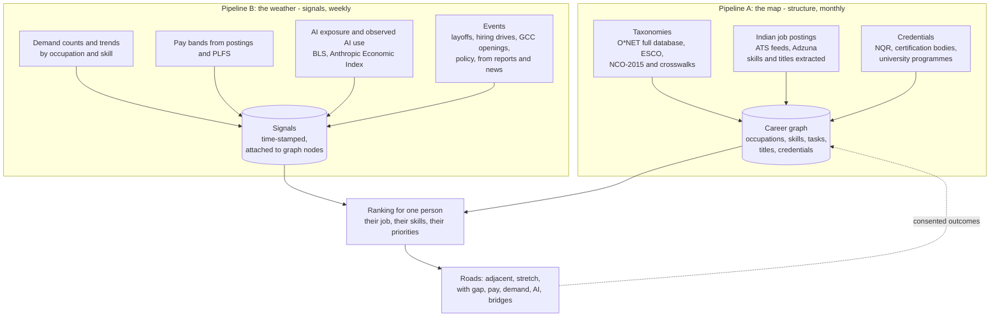

# Career graph: the adult product's core

Status on 28 Oct 2026: design only. Nothing below is built. The existing school pipeline runs (checked on 28 Oct 2026: 16 fields, 83 careers, 0 validation errors, 239 fact-check claims).

## The correction (28 Oct 2026)

The earlier drafts treated adults as an extension of the school product: the same walk and engine at the centre, the same 16 school-stream fields, with a graph added on the side. That was wrong.

- **A student needs the 10,000-foot view.** Which broad field, which stream, which exam. The interest walk and the 16 fields are right for that.
- **A working adult needs street level.** Starting from the job they hold today, they go deeper (the skills in it, what is rising and falling, what AI already does) and wider (adjacent roles, stretch roles, and the skills and credentials that bridge them). The unit is the occupation and the skill, not the field. The core is the map of how jobs and skills connect.

**One map, two zoom levels.** The adult graph is the master data. The school product's 16 fields become clusters of occupations on the same graph, so students see the continent and adults see the streets. Work on the graph improves both.

For adults the interest walk becomes an optional lens ("not sure what you enjoy? An 8-minute walk adds an interest lens"), not the entry point.

## Two pipelines

### Pipeline A: the map (structure)

What exists and how it connects. It changes slowly, so it runs monthly.

| Input | What it adds | Notes |
| --- | --- | --- |
| **O*NET full database** (CC BY 4.0) | About 900 occupations, each with skills, knowledge, abilities, work activities, tasks, technology skills (named tools and software), related occupations and alternate titles | Today the repository reads only interests, wages and tasks for 83 careers. The full download is the backbone |
| **ESCO** (the EU's occupations and skills classification) | About 3,000 occupations and over 13,000 skills, with "essential" and "optional" links between them, mapped to ISCO-08 | A finer skill vocabulary than O*NET. Check its licence before use |
| **NCO-2015 and crosswalks** | Indian occupation codes (built on ISCO-08), joined to SOC through the published ISCO to SOC crosswalk | The India link. NCO is also what PLFS pay data uses |
| **Indian job postings** (ATS feeds of a curated company list, Adzuna) | Real Indian job titles, and which skills appear with which titles. This is the "skills that go together" layer | This is the collection step, done within each source's terms. Keep extracted titles, skills and counts, not the postings themselves |
| **Credentials** (NQR, certification bodies, university programmes) | `teaches` links from a credential to skills, with duration and cost | Every link carries a word-for-word quote from the official page (AI_LAYER.md quote check) |

**Output.** `data/graph/graph.sqlite`, with nodes (occupation, skill, task, title, credential, cluster) and edges (`needs`, `has_task`, `close_to`, `co_occurs`, `teaches`, `in_cluster`, `is_title_of`, `moved`). Every node and edge carries `source`, `trust`, `as_of`. Validation checks:

- no orphan skills;
- every occupation has at least 10 skills;
- every crosswalk link resolves;
- no edge without a source.

### Pipeline B: the weather (signals)

What is changing, and how strongly. It runs weekly, and it attaches time-stamped values to nodes. It never adds or removes structure.

| Signal | Attached to | Source |
| --- | --- | --- |
| Posting volume and its 3-month and 12-month trend | Occupation, skill | ATS feeds, Adzuna |
| Pay band in India | Occupation | Postings that show pay (`secondary`), PLFS (`official`, broad group) |
| AI exposure and observed AI use per task | Occupation, task | BLS categories, Anthropic Economic Index (both exist today) |
| Rising and falling skills | Skill | Change in the share of postings that mention it |
| Events | Occupation, skill, industry | Public reports and news, read by the counsel with the quote check: hiring drives, layoffs, new GCCs, policy changes |
| Network pulse | Occupation, skill | Monthly answers from people in the founder's network who hire, shown from 5 answers up |

Each signal keeps its history, so the app can say "rising for 3 months" and not only show today's number.

**What "ranks" means.** Signals rank roads, they never rewrite the map. A falling demand trend pushes a road down; it does not delete the road. A person who wants that road still sees it, with the signal next to it.

## What a working adult sees

1. **Where you stand.**
   - **Current job:** typed and matched to an occupation (AI_LAYER.md).
   - **Industry and years of work.**
   - **Skills you have:** pre-ticked from the occupation's top skills, so you edit a list rather than write one.
2. **Deeper: your own job today.** The skills in it, each marked rising, steady or falling in India. The tasks AI already does, and the ones where no AI use has been seen yet. How pay for the job is moving.
3. **Wider: the roads out.**
   - **Adjacent roles (one step):** most of your skills carry over.
   - **Stretch roles (two steps):** a real gap, but a known bridge.
   - **Each road shows:** the skills to add, the pay change, the demand trend, AI exposure, and the credentials that bridge the gap (with duration and cost from the official page).
4. **Your priorities set the order.** Sliders for what matters: pay, staying safe from AI, a short move, demand, interest fit (only if the walk was taken). The order follows the person's weights, and every road shows how its components add up, so nothing is a black box. The default is equal weights.
5. **Drill anywhere.** Open a skill to see every role that needs it. Open a role to see its roads. Open a credential to see which roads it opens. This is how "deeper and wider" works on screen.
6. **The interest walk (optional)** adds an "enjoy" lens to every road. It is the same engine and is never retrained.

The lamp art can still frame this as a map (your lamp, roads, brighter lamps for demand, fog for AI exposure), but it is a skin on the graph, not the logic.

## The system learns as it is used

| From the person | Feeds | Shown only when |
| --- | --- | --- |
| Typed job titles they confirm | Pipeline A: `is_title_of` | Reviewed |
| Skills they tick that the occupation lacks | Pipeline A: proposed `needs` edges for Indian versions of a job | 5 or more people, then reviewed |
| A target they add that we did not suggest | Pipeline A: proposed `close_to` edge | 5 or more people, then reviewed |
| Follow-up at 3, 6 and 12 months (opt-in): did you move, to what, what helped | Pipeline A: `moved` and `moved_via` edges, `trust: observed` | 5 or more people, then reviewed |
| Roads opened | Neither pipeline. Only the content queue (what to review next) | Never shown as advice |

**Guardrails:**

- **Popularity is not evidence.** Clicks never change the ranking.
- **No single person can tip the graph.** One verified email counts once per edge.
- **Every user-derived edge needs the founder's approval** in the weekly pull request.
- **Withdrawal.** A person who withdraws is removed from the next build.
- **The moat.** Confirmed Indian career moves, and what helped make them, exist in no public dataset. That is the asset this loop builds.

## Collecting the data, within the rules

Pipeline A collects and extracts. That is fine where the source allows it:

- open taxonomies under open licences;
- employers' own ATS job feeds, which are published for embedding;
- APIs with keys (Adzuna);
- public reports, which are read and quoted.

**What stays out:** LinkedIn, Indeed and Naukri pages. Their terms forbid automated collection and they block bots, and a product built on trust cannot rest on breaking terms. If one of them offers a licensed data feed later, it slots into Pipeline A as one more source.

## Operating it

- **Pipeline A.** Monthly, as `pipeline/graph.py`, with the same validate, change report and `--accept` flow as today.
- **Pipeline B.** Weekly, as `pipeline/signals.py`.
- **Both are run by a scheduled Claude Code session** that opens a pull request and never merges. The session reads live usage only as aggregate counts from 5 up, through an admin endpoint, so it never sees personal data. It needs network access to the source hosts and two secrets: the admin key and the Adzuna key.

## Build order (adult-first)

1. **Pipeline A v0 from open data only.** The O*NET full database and the crosswalks, built into SQLite with checks. No postings yet. This is enough for "where you stand", the deeper view and adjacent roles.
2. **The adult result v0.** Current job, ticked skills, deeper view, roads with skill gap and AI exposure. Demand shows "not yet measured".
3. **Pipeline B v0.** AI signals (they already exist) and PLFS pay, then the ATS feeds for the founder's company list.
4. **Postings into Pipeline A.** Indian titles and skill co-occurrence.
5. **Priorities sliders and drill-down.**
6. **The learning loop.** "Add your own road", ticked-skill proposals, follow-ups, network pulse.
7. **The scheduled weekly session.**
8. **Back to schools.** The 16 fields re-derived as clusters of the graph.

## Open questions for the owner

1. Which 150 to 300 companies go on the posting list first?
2. Email Adzuna about commercial terms now, or start with ATS feeds only?
3. Which industries does your network sit in? Pipeline A v0 should be deepest there first.
