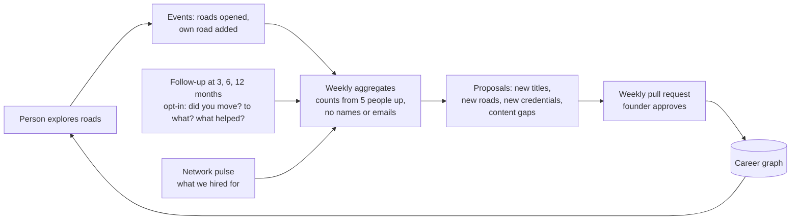

# Career graph and the learning loop

Status on 28 Oct 2026: design only. Nothing below is built. The existing pipeline runs (checked on 28 Oct 2026: 16 fields, 83 careers, 0 validation errors, 239 fact-check claims); this design extends it.

## The idea in one paragraph

Everything Margwise knows becomes one graph:

- jobs, skills, tasks, credentials and fields are the nodes;
- "needs", "teaches", "is close to" and "people moved from here to there" are the edges.

A weekly run refreshes it from public sources and from demand signals, and opens a pull request for the founder to approve. A working adult is placed on the graph at their current job and shown the roads out of it. Each road is seen through four separate lenses: interest fit, skill gap, demand in India and AI exposure. What people go on to do, when they agree to tell us, adds new roads. The graph learns; the interest engine does not.

## Nodes and edges

Every node and edge carries `source`, `trust` (official, secondary, estimate, or the new `observed`), `as_of` and `cadence`, exactly like `data/sources.yaml` entries today.

| Node | Key | From |
| --- | --- | --- |
| Occupation | SOC code, plus NCO-2015 and ISCO-08 codes through crosswalks | O*NET (today), BLS SOC to ISCO crosswalk, NCO-2015 (built on ISCO-08) |
| Skill | O*NET skill, knowledge and technology element ids; ESCO skill ids where mapped | O*NET, ESCO (EU, open, mapped to ISCO) |
| Task | O*NET task id | O*NET, with AI use from the Anthropic Economic Index (today) |
| Field | Our 16 fields | `data/content.py` |
| Credential | Degree, exam, certification or NSQF qualification | Official bodies; National Qualifications Register (NQR) |
| Job title | A typed title, normalised | O*NET alternate titles, then user-confirmed titles |
| Demand point | Occupation or skill, month, source | Demand signals, below |

| Edge | Meaning | Weight |
| --- | --- | --- |
| `needs` | Occupation needs skill | O*NET importance and level |
| `has_task` | Occupation has task | Task share; AI-use flag |
| `close_to` | Occupation is close to occupation | O*NET related occupations, plus skill overlap computed by us |
| `teaches` | Credential teaches skill | From the official syllabus or NQR qualification file, with a quote |
| `in_field` | Occupation is in field | Ours, as today |
| `is_title_of` | Job title means occupation | Dictionary (AI_LAYER.md) |
| `moved` | People moved from occupation A to B | Count of consented, confirmed moves; `trust: observed` |
| `moved_via` | A move used a credential | Count, from the same follow-ups |

**Storage.** A single SQLite file built by the pipeline (`data/graph/graph.sqlite`, with `nodes` and `edges` tables), queried with NetworkX in Python. No graph database server: the graph is a few hundred thousand edges at most, which SQLite handles easily. The app gets small precomputed JSON slices, one per starting occupation, so the page stays static and fast. A graph server can come later if live queries are ever needed.

## Demand: what is hot in India, legally

Scraping LinkedIn or Indeed breaks their terms of use, both block bots, and Margwise's edge is being trustworthy. So no scraping. The only job connector this account has (ZipRecruiter) covers the US and Canada only. Use these instead, each recorded in `sources.yaml` with its trust level:

| Signal | What it gives | Notes |
| --- | --- | --- |
| **Employer job boards through their public ATS feeds** (Greenhouse and Lever publish open postings as JSON for embedding on career sites) | Real postings with full descriptions, for a curated list of companies hiring in India | Keep a list of 150 to 300 companies in `data/demand/companies.yaml`. Read each ATS's terms first. Store counts and extracted skills, not the postings |
| **Adzuna API (India market)** | Posting counts and salary hints by title and keyword | Free developer key. Commercial use needs Adzuna's agreement and "Jobs by Adzuna" attribution, so email them before launch |
| **Public reports** | Sector and role trends, for example the Naukri JobSpeak monthly index, LinkedIn's Jobs on the Rise India, India Skills Report, and National Career Service vacancy figures | Read by the counsel (AI_LAYER.md) with a word-for-word quote check. `secondary` trust |
| **O*NET Hot Technologies and In Demand flags** | Skills that show up most in postings | US-based, already joinable on SOC |
| **The founder's network as a sensor** | Once a month, 3 questions to consenting professionals who hire: "Did your team hire this quarter? For which role? Which 3 skills decided it?" | The most current signal, from people the founder can verify. `observed` trust, shown only from 5 answers up |

Demand is shown as a direction (rising, steady, falling) with its sources and month. It is never a single "hotness score", because the signals cover different slices of the market.

## Placing a person on the graph

1. **Where you stand.** The current job is matched to an occupation by title (AI_LAYER.md). An optional "skills I already have" list follows, pre-ticked from that occupation's top skills, so the person only edits it.
2. **Your interests.** The existing walk and engine, unchanged.
3. **Roads out.** Candidate targets come from `close_to` and `moved` edges, plus the best-fitting occupations in the person's top three fields.
4. **Four lenses, never blended into one score:**
   - **Interest fit:** from the engine, as today.
   - **Skill gap:** the skills the target needs that the person has not ticked, weighted by importance.
   - **Demand in India:** the direction and its sources.
   - **AI exposure:** of the target, next to the current job.
5. **Bridges.** For each road, the cheapest path through `teaches` edges: which credentials cover the gap, with duration and cost from the official page. Where people have made this move, `moved_via` shows what they used, from 5 people up.
6. **What AI is taking in your job now.** The person's current tasks, sorted into "AI is used for this today" and "no AI use seen yet" (data that already exists). Roads that lean on the second group are highlighted. For professionals this is often the most useful screen, and it needs no new data.

**The story becomes the map.** For adults, the result screen can be the lamp map itself:

- the person stands at their own lamp (the current job);
- roads lead to other lamps;
- a road's length is the skill gap;
- a lamp's brightness is demand;
- fog over a lamp is AI exposure;
- way-stations on a road are credentials.

This uses the existing art style and gives the walk a purpose.

## The learning loop

**What learns and what does not:**

| Learns from use | Never learns from use |
| --- | --- |
| The job-title dictionary (confirmed titles) | The interest engine and its scores. These stay fixed and calibrated, or test-retest and validation mean nothing |
| New roads (`moved` edges), but only from confirmed follow-ups, not from clicks | The order of fields, which comes from interest fit |
| Which credentials people actually used (`moved_via`) | Facts such as fees, exam rules and pay, which come only from sources |
| The content queue: which roads people open that have no reviewed card yet | |
| "Add your own road": a target we did not suggest becomes a proposal | |

**Guardrails:**

- **No herd effect.** Clicks never raise a road's rank. If everyone opens "data science", that sets the content queue, not the advice. "People like you also explored" is either shown as its own labelled lens or not at all.
- **Minimum group of 5.** No count, road or credential learned from users is shown until at least 5 different people back it.
- **No single person can tip the graph.** Each verified email counts once per edge, and new `moved` edges need the founder's approval in the weekly pull request.
- **Consent.** The adult notice says that anonymised choices improve the map. Follow-ups need their own opt-in (the research tick or a separate one). Withdrawing removes a person's events from the next weekly build.
- **Cold start.** Seed the graph from O*NET related occupations, crosswalks and NQR. Then add 30 to 50 "how I switched" stories from the founder's network: before, after, what helped, how long, entered as `observed` edges with each person's consent.

**The real moat.** The PRICING_AND_MARKET doc names "consented outcome data" as hard to copy. Confirmed Indian career moves, with what helped, are exactly that. No public dataset has them.

## The weekly run as a scheduled Claude Code session

The founder does not need to run the pipeline by hand. A scheduled cloud session can be the operator:

1. **Monday (time to be chosen).** A fresh session checks out the repository on a new branch.
2. It runs `python3 pipeline/run.py --fetch` (sources), then `pipeline/demand.py` (ATS feeds, Adzuna, reports), then `pipeline/graph.py` (rebuild and checks).
3. It pulls **aggregates only** from the live site through a new admin endpoint, `GET /api/admin?aggregates=1`. That endpoint returns only counts from 5 up: no names, emails or individual events. So the scheduled session never sees personal data.
4. The counsel (AI_LAYER.md) writes change notes and proposals, which pass the quote check and `validate.py`.
5. The session opens a pull request: what changed, new proposals, a coverage figure and failures. **It never merges or deploys.** The founder reviews, merges, runs `--accept` and deploys.

Needs before this can run:

- **Network access.** The environment's network settings must allow the source hosts: onetonline.org, bls.gov, the exam bodies, the ATS feeds, Adzuna and the report sites.
- **Secrets.** An admin key for the aggregates endpoint, and an Adzuna key, as environment secrets, never in the repository.
- **Cost.** Each run uses the founder's Claude usage. Weekly for sources, monthly for demand, is enough.

## Build order

1. **Graph v0 from what exists.** O*NET occupations, skills, tasks, related occupations and alternate titles; our fields; the AI layer; the SOC to ISCO to NCO crosswalks. Build to SQLite with checks. No new outside data yet.
2. **Professional result v0.** Where you stand, the four lenses, and "what AI is taking in your job now". Demand shows "not yet measured".
3. **Seeding from the network.** 30 to 50 switch stories as `moved` edges.
4. **Demand v1.** The ATS feed list and public reports, then Adzuna once its terms are agreed.
5. **The weekly scheduled session,** with the aggregates endpoint and pull requests.
6. **Learning loop.** "Add your own road", the follow-up emails and the network pulse.
7. **The lamp map** as the adult result view.

## Open questions for the owner

1. Which 150 to 300 companies go on the ATS list first? Your league is the obvious start: the firms your network works at and hires from.
2. Will you email Adzuna about commercial terms now, or start without it?
3. The NQR has a public search, but no bulk download was found. Ask NCVET for data access, or start with certifications from official bodies only?
4. What day and time should the weekly run happen, and should it run weekly or only monthly at first?
