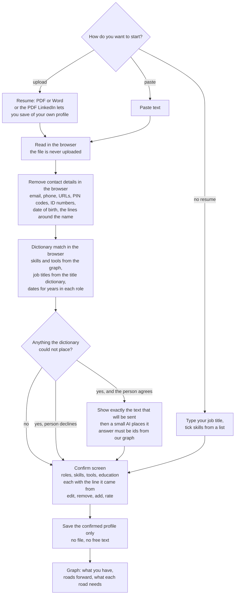

# Skills intake: how a working adult tells us what they can do

Status on 28 Oct 2026: design only. Nothing below is built. It feeds "Where you stand" in `docs/CAREER_GRAPH.md`.

## The idea, and the two changes to it

The owner's idea: the person uploads a resume; regex strips the name and contact details; a small AI turns the rest into a fixed format; the format is matched to the graph to find the skills the person has, the roads forward, and the skills missing for each.

The idea is right. A resume is the lowest-effort way for a working adult to give years of experience, and nobody wants to tick 40 boxes. Two parts change:

1. **Regex cannot make a resume anonymous.** A name has no fixed pattern. Indian resumes often carry a photo, date of birth, father's name, marital status, religion, a passport number and a home address. Even with all of that removed, employer names, job titles and dates together identify a person. So the stripped text is still personal data, and the design must not pretend otherwise.
2. **Most of the matching needs no AI at all.** The graph already holds the vocabulary: tens of thousands of skill and tool names, with alternate spellings, from O*NET and ESCO. Matching a resume against that list is a dictionary lookup that can run in the person's browser. AI is only needed for the part the dictionary misses, and only with the person's say-so.

The result: **the resume never leaves the person's device.** Only the confirmed, structured profile is saved. That is a stronger privacy promise than any redaction, and it costs no AI calls in most cases.

## The flow

### 1. Ways in

- **Upload a resume** as PDF or Word.
- **The PDF LinkedIn lets people save of their own profile.** This is the person's own data, downloaded by them, so it is fine. Margwise never logs in to LinkedIn or reads LinkedIn pages.
- **Paste text.**
- **No resume:** type the current job title and tick skills from that occupation's list. This path always works, and it is the fallback for every failure below.

### 2. Reading the file, in the browser

- **PDF** text comes out with pdf.js, and **Word** with mammoth.js, both bundled with the page.
- **Limits.** Files up to 5 MB and 10 pages.
- **Scanned PDFs** have no text, so they are not run through OCR. They get: "This looks like a scanned image. Paste the text instead, or use the list."
- **The server never receives the file.** That also removes a whole class of upload attacks.

### 3. Removing contact details, in the browser (regex is right here)

Patterns catch what has a pattern:

- email addresses;
- Indian and international phone numbers;
- URLs and social handles;
- PIN codes;
- PAN, Aadhaar and passport-like numbers;
- dates of birth near the words "DOB" or "date of birth".

Lines labelled "Name", "Father's name", "Address", "Religion", "Marital status", "Gender", "Nationality" or "Languages known" are dropped whole. The top 3 lines of the resume are dropped, which is where the name usually sits.

This step is a courtesy that keeps the later steps tidy. It is not anonymisation, and the notice does not claim it is.

### 4. Dictionary matching, in the browser

The page loads a compact matcher built by Pipeline A (`skills_index.json`):

- every skill, tool and technology name in the graph, with alternate labels;
- the job-title dictionary;
- common Indian abbreviations, for example "SAP FICO", "MIS", "BFSI" and "KYC".

Matching is whole-word and ignores case, using one fast multi-pattern search. Roles come from title-plus-date blocks, so years in each role are counted. Each skill takes the date of the role it appears in, so the profile knows **when a skill was last used** as well as whether it was used. Recency matters: a skill last used in 2014 is not the same as one used this year.

### 5. AI only for what is left, and only with consent

Phrases the dictionary did not place go to the AI. Examples: "built a reconciliation bot for vendor payments", or an in-house tool name. Before anything is sent, the person sees the exact text that will leave the device and a button: "Send these lines to an AI service to match them". It is off until they press it.

- **The model** is the live provider from `AI_LAYER.md` (a paid tier with a spend cap, no training on prompts). It never goes to a free tier.
- **The answer must be a list of skill and occupation ids from our graph,** with the source line for each. The server drops any id that does not exist. The model cannot add free text to the profile.
- **The resume text is data, not instructions.** A resume can hide white-on-white text such as "ignore your instructions". The schema check and the id check make such text harmless.
- **Nothing is logged.** Neither the text nor the reply is stored. The person's daily AI limit from `AI_LAYER.md` applies.

### How accurate is it without a large model? (three tiers)

Expected strengths and weaknesses, to be measured with the 30-resume test. No figure is claimed until then.

| Tier | Runs | Good at | Misses |
| --- | --- | --- | --- |
| **1. Dictionary** | In the browser, no AI | Named things: tools, software, certifications, standard skills ("SAP FICO", "Power BI", "GST", "Python", "IFRS"). High precision | Skills implied by achievements ("cut month-end close from 10 to 4 days" means financial close and process improvement). Ambiguous words ("R", "Go", "Spring", "Excel" as a verb). Two-column layouts, tables and text inside images. Unusual date formats |
| **2. Small embedding model** | In the browser (a sentence-embedding model of about 25 MB, loaded once and cached) | Implied skills. Each achievement sentence is compared with the graph's skill descriptions, and the closest skills are suggested above a threshold. Nothing leaves the device | Sentences that need reasoning across lines, and very new terms not yet in the graph |
| **3. Language model** | Server, the paid tier, with consent | Whatever is still unplaced, and messy layouts. Its answer must be graph ids | Costs money. The text leaves the device, so it needs consent |

Two things lift accuracy whichever tier is used:

- **Role suggestions.** "People in your role usually have" suggests the skills a resume leaves out.
- **The confirm screen.** The person fixes what was missed.

The measure that matters is not what the parser finds alone. It is how many confirmed skills the person did not have to type.

**Decision after the 30-resume test.**

- **Tiers 1 and 2 together reach 70 percent recall at 85 percent precision:** the language model stays optional.
- **They do not:** the language model step becomes the default. It is still announced before upload ("Your resume text will be sent to an AI service to read it. Turn this off to keep it on your device") and can be switched off. The person then sees a lower-quality but private result.

### 6. The confirm screen (the most important step)

A resume shows what someone claims, so the person's own confirmation is the real input.

- **Roles:** title, matched occupation, industry and years. The person can edit any of them.
- **Skills and tools:** shown as chips, each showing the resume line it came from, grouped under the roles they appeared in.
- **For each skill, a quick rating:**
  - **I've used it:** occasional use.
  - **I'm strong at it:** regular use, could teach it.
  - **I'm rusty:** last used over 3 years ago, filled in from the dates and changeable.
- **Suggestions:** "Skills people in your role usually have" lists the occupation's top skills from the graph that the resume did not mention. One tap adds each. Resumes leave out the obvious.
- **Education and certifications:** level, field and year, matched to credential nodes.

### 7. What is saved

Only the confirmed profile, as structured ids, nothing more:

- **roles:** occupation id, industry, years band;
- **skills:** skill id, rating, last-used year;
- **credentials:** credential id, year.

What is not saved:

- the file;
- any extracted or free text;
- any employer name;
- any college name;
- anything the person removed.

The profile is covered by "See what you keep", "Delete my data" and retention, like every other adult record. The person can re-upload at any time to refresh it.

## Matching the profile to the graph

For each candidate road (a target occupation):

- **Need.** The target's skills, weighted by importance from O*NET or ESCO "essential" links, and by how often Indian postings for that role mention them (Pipeline A).
- **Have.** The person's confirmed skills. "Strong" counts fully, "used" counts at 0.7 and "rusty" at 0.4. Close skills count partly. For example, PostgreSQL covers part of a need for SQL, through the graph's skill-to-skill links.
- **Gap.** The weighted needs not covered, in order. For each missing skill:
  - why it matters (importance, and the share of postings that ask for it);
  - how hard it usually is (the credential hours that teach it);
  - whether demand for it is rising (Pipeline B).
- **Coverage.** The percentage of the target's weighted needs the person already meets. This is the "length of the road" on the map.
- **Bridges.** The smallest set of credentials whose `teaches` links cover the biggest share of the gap, with duration and cost from the official pages.

The person sees several roads, each with coverage, gap, bridges, pay change, demand and AI exposure, ordered by their own priority sliders. The roads come in three kinds:

- **Adjacent:** coverage of 70 percent or more.
- **Stretch:** 40 to 70 percent.
- **Leap:** under 40 percent, shown only on request.

## Where the "need" side comes from

The skills each target needs come from the sources already chosen in `CAREER_GRAPH.md`, Pipeline A:

- the O*NET and ESCO occupation-to-skill links;
- skill frequencies from Indian job postings collected through employers' public ATS feeds and the Adzuna API.

LinkedIn, Indeed and Naukri pages stay out of the pipeline, because their terms forbid automated collection. A person's own LinkedIn PDF, uploaded by them, is a different thing and is welcome.

## Data protection

- **Notice.** The adult notice adds: "If you upload a resume, it is read on your device. We keep only the roles, skills and qualifications you confirm. If you choose to send unmatched lines to an AI service, those lines go to that service and are not stored by us."
- **Special details.** Resumes can contain health, disability, caste or religion details. These are never matched or saved: the dictionary has no entries for them, and the AI's answer can only be skill, occupation or credential ids.
- **Ask the lawyer** in the same hour about the AI provider as a processor (already listed).

## Decision rules (frozen before data)

Run the steps on 30 resumes from the founder's network, with each person's consent, then compare with what each person confirms:

| Measure | Rule |
| --- | --- |
| Skill precision | At least 85 percent of the skills the dictionary suggests are kept by the person |
| Skill recall | At least 70 percent of the skills the person ends up confirming were suggested by the dictionary, the AI or the role suggestions, without typing |
| Role match | At least 90 percent of current roles match the right occupation, after at most one edit |
| Time | The median time from upload to confirmed profile is 4 minutes or less |
| AI use | Record how often the dictionary alone was enough. Below 50 percent means the dictionary needs work |
| Contact removal | Check the 30 by hand: count any email, phone, ID number or address left in the text that would have been sent to the AI. Target zero; any miss becomes a new pattern |

## Build order

1. `skills_index.json` from Pipeline A v0 (O*NET technology skills, skills and alternate titles), plus a hand-made list of Indian abbreviations.
2. The browser reader, contact removal and dictionary match, with the confirm screen. No AI.
3. The gap and coverage calculation, and the roads view.
4. The optional AI step for unmatched lines.
5. ESCO labels and posting-based skill weights, as Pipeline A grows.
