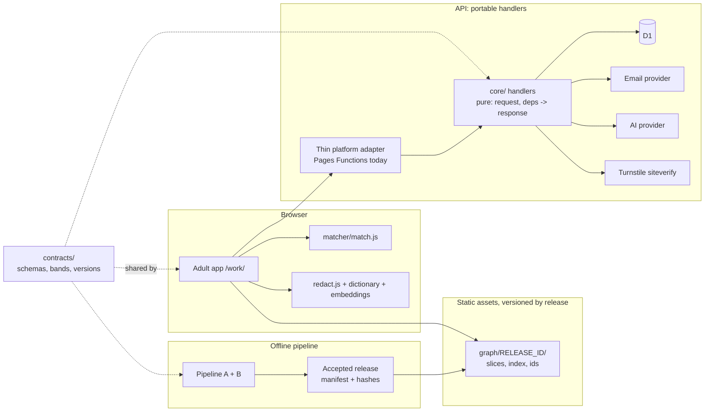

# Backend architecture: decisions, invariants and failure modes

Status: authoritative with `SPEC.md`, 28 Oct 2026. The goal is a backend where small mistakes cannot quietly compound. Every decision below records **why**, so a later change is made on purpose and not by drift. Changing a decision needs a new ADR (Architecture Decision Record) and the owner's approval (`DELIVERY.md`, change control).

## Quality goals, in priority order

1. **Correctness and trust.** A shown fact is sourced. A stored profile never silently loses meaning. A result can be reproduced.
2. **Privacy.** Minimum data. Deletion is complete. Nothing personal leaks through logs, errors, backups or third parties.
3. **Evolvability.** Taxonomies, schemas, the matcher, the platform and providers will all change. Each can change without breaking the others.
4. **Operability.** One person can run it. Problems are visible early, and recovery is rehearsed.
5. **Cost.** Near zero at pilot scale, with hard caps on anything metered (email, AI).

## Architecture in one picture



## Decision records

### ADR-01. Platform: stay on Pages for v1, keep handlers portable

- **Context.** The site runs on Cloudflare Pages with Pages Functions today, and it works and is tested. Cloudflare's documentation now advises starting new projects on Workers with static assets, because that is where new features land.
- **Decision.** Keep Pages for v1, but write every adult endpoint as a **pure handler** in `hosting/core/` with the shape `handle(request, deps) -> Response`. `deps` holds `db`, `now()`, `random()`, `email`, `ai`, `turnstile`, `log`, `config` and `assets`. The Pages Function files in `hosting/functions/api/` are one-line adapters that build `deps` from `env`.
- **Why.** Moving to Workers later becomes a routing change, not a rewrite. Handlers can be tested without any platform, using fake `deps`. Time and randomness can be injected, so expiry and rate limits are testable.
- **Consequences.**
  - Security headers for API responses are set in the shared `json()` helper, because `_headers` rules do not apply to Functions' responses.
  - Migrating to Workers is a later ADR, triggered by a concrete need: cron triggers, queues or a platform deprecation.

### ADR-02. Environments: local, preview and production never share data

- **Context.** Today there is one D1 database (`margwise-test`), used by the live site.
- **Decision.** Three environments:

| Environment | D1 | Email | AI | Turnstile |
| --- | --- | --- | --- | --- |
| Local (`wrangler pages dev`) | Local SQLite in `.wrangler/` | `EMAIL_DRY_RUN=1` | Fake provider | Test keys that always pass |
| Preview (branch deploys) | A separate database, `margwise-preview`, as `preview_database_id` | Dry run, or an allow-list of the owner's addresses | Real, with a tiny cap | Test keys |
| Production | `margwise-test` (renamed or recreated as `margwise-prod` at the pilot) | Real | Real, with the ₹500 cap | Real keys |

- **Secrets.** Each environment has its own secrets. A preview key never works in production.
- **Owner actions.** Create the preview database, set `preview_database_id` in `wrangler.toml`, and create Turnstile site keys.
- **Why.** A test run that writes to production data, or a preview that emails real people, is exactly the kind of small slip that becomes an incident.

### ADR-03. Migrations: use D1's migration system, forward-only and additive

- **Context.** Schemas are applied today as `hosting/schema*.sql` by hand, with no record of what has been applied where.
- **Decision.** Move to `wrangler d1 migrations`, with `migrations_dir = "hosting/migrations"`. D1 records applied migrations in its `d1_migrations` table.
  - **`0000_baseline.sql`** is the combined current schema (schema.sql to schema12.sql), so that **new** databases (local, preview) can be built.
  - **On the existing production database,** the baseline is marked as applied by inserting its row into `d1_migrations`. The procedure goes in the runbook. SQLite `ALTER TABLE ADD COLUMN` cannot be made idempotent, so the baseline must never be re-run on production.
  - **`0001_adult.sql`** and onward are new.
- **Rules:**
  1. **Forward-only.** Never edit an applied migration. Fix with a new one.
  2. **Additive by default.** Add nullable columns and new tables. Renames and drops use **expand, migrate, contract** over two releases: add new, write both, backfill, switch reads, and only later drop.
  3. **Every migration is tested** by applying all migrations to an empty database in `fakedb` and running the API tests. Before production, rehearse on a local copy of a production export (`wrangler d1 export`, stored only on the owner's machine and deleted afterwards).
  4. **A CI guard** (`hosting/tests/migration_guard.mjs`) fails on file-number gaps or duplicates, and on any `DROP`, `DELETE` without `WHERE`, or `UPDATE` without `WHERE`, unless the line carries `-- reviewed-destructive: <ADR id>`.
  5. **Code must work on both the old and the new schema** during a deploy (deploy code first, migrate second, for additive changes).
- **Why.** Schema drift between environments is the most common silent backend failure.

### ADR-04. Identity, sessions and keys

**Separate keys** (all secrets, each at least 32 random bytes):

| Key | Used for |
| --- | --- |
| `SIGN_KEY` | Session tokens, as today |
| `EMAIL_KEY` | `email_hash`, a keyed hash for look-ups |
| `CODE_KEY` | One-time code and link hashes |
| `IP_KEY` | IP bucketing |

One key per purpose means a leak or a rotation affects only that purpose.

**Key versions.**

- New adult tokens are `v1.<issued-at>.<mac>`. A new key version is added beside the old one, both are accepted for an overlap of 31 days, then the old one is removed.
- `email_hash` can be recomputed during a rotation, because the email address is stored (it is needed to send codes).

**Email normalisation.** Trim, apply Unicode NFKC, and lower-case the whole address. **No provider-specific tricks** such as removing Gmail dots or `+tags`: they are lossy and differ between providers.

**One-time codes.**

- 6 digits from `crypto.getRandomValues`, stored as an HMAC.
- 15-minute expiry, at most 5 tries, then the code is void.
- Comparison takes the same time whatever the input.
- A link token is 32 random bytes, single use.
- Requesting a new code invalidates the old one.

**Sessions.**

- 31 days, sliding, refreshed on use at most once a day.
- `tok_after` revokes everything ("Log out everywhere", admin revoke, and every key rotation).
- The token travels in an `Authorization: Bearer` header from `localStorage`. It never goes in a URL. The existing pattern stays, but adult tokens are scoped to `track=adult`.

**Abuse.**

- Turnstile is verified on the server on `email/start` and `ai/read`.
- Per-address limits: 3 codes an hour, 10 a day.
- Per-IP-bucket limits (as today) and a site-wide daily cap.
- Responses are generic, so they never reveal whether an address is registered.
- Cloudflare rate-limiting rules form an outer layer (owner configuration).

### ADR-05. Stable ids across graph releases (the most important rule)

- **Context.** Profiles store graph ids such as `skl:2.A.1.a` and `occ:15-1252.00`. Taxonomies change: O*NET-SOC versions renumber occupations, skills merge, and new AI-era roles are retired. Without a rule, a release silently empties people's profiles or changes their meaning.
- **Decision.** `data/graph/id_registry.json` is **append-only**. Every id ever published has an entry:

  ```
  {id, kind, label, first_release, status: live|tombstone, replaced_by: [ids] | null, note}
  ```

  1. **Ids are never reused.**
  2. **Removed ids become tombstones,** with `replaced_by` taken from official crosswalks (for example O*NET's taxonomy crosswalk) or the owner's mapping.
  3. **A CI check** confirms that every id in any previous release's manifest exists in the registry, and that every live id in the current release is `live`.
  4. **`contracts/migrate_ids.js`** (shared by the browser and the server) maps a profile's tombstoned ids to their replacements on read. Ids with no replacement are removed from the active profile and listed, so the UI can say "We updated our skill list. Please re-check these 2 skills". The stored profile is rewritten only after the person confirms.
  5. **The last 3 accepted releases** are served at `/work/graph/<release_id>/`, so a stored result can be shown with the data it was made from. Older releases are kept in git tags.
- **Why.** This is the one problem that is impossible to fix after the fact: once meaning is lost from stored profiles, it cannot be recovered.

### ADR-06. The profile is one versioned document with optimistic concurrency

**Storage.** `profiles(tester_id PRIMARY KEY, v INTEGER, rev INTEGER, data TEXT, job_release, matcher_version, updated_at)`.

- `data` is at most 32 KB of JSON.
- `v` is the schema version of `data`.
- `rev` increases by 1 on every write.

**Concurrent edits.**

- A write sends the `rev` it started from. The server runs `UPDATE … WHERE tester_id = ? AND rev = ?`.
- If no row changed, the server returns `409` with the current document. The client shows "This profile changed on another device" and offers "Keep mine" or "Use the newer one". It never merges silently.

**Schema changes.** Each change from `v` to `v + 1` is a pure function in `contracts/profile_migrations.js`, with tests. The server upgrades on read, and writes only the current `v`.

**Why one document.** A person edits their profile as a whole. Splitting it over many tables adds joins and partial-write states with no benefit at this scale.

### ADR-07. Contracts first, in one place

**Contents.** `contracts/` holds:

- JSON Schemas: `profile`, `slice`, `skills_index`, `extract` (AI output), `events`, and every API request and response;
- `bands.json`;
- `versions.json`: `MATCHER_VERSION`, `PROFILE_V`, `SLICE_V` and `API_V`.

**Who uses them.** Browser code, server handlers and pipeline exports all validate against the same files.

**Validator.** `contracts/validate.js` is a small dependency-free validator for the subset of JSON Schema we use:

- `type`, `required`, `properties`, `additionalProperties: false`;
- `enum`, `items`, `minItems` and `maxItems`, `pattern`;
- `minLength` and `maxLength`, `minimum` and `maximum`;
- `$ref` within the file.

It has its own tests. The Python pipeline calls it through `node contracts/validate.js <schema> <file>`.

**Rule.** A change to any contract file changes its version in `versions.json` and needs the architect hat's review (DELIVERY.md).

**Why.** Different shapes on the client, the server and the pipeline are the classic slow-burn bug.

### ADR-08. Matching happens in the browser; client data is untrusted

- **Where matching runs.** The matcher runs in the browser on the person's profile and on static slices. The server never recomputes results.
- **Client events are analytics, not facts.** Result events (`roads_viewed`, `road_added`) are reported by the client, so they are treated purely as analytics:
  - validated against schemas;
  - ids checked;
  - capped per tester per day;
  - never used directly to change anything.
- **The learning loop** only aggregates from 5 or more distinct testers, and every graph change goes through the owner's approval.

### ADR-09. API conventions

- **Base path.** `/api/v1/...` for adult endpoints. Existing student endpoints stay where they are.
- **Request and response bodies.**
  - Bodies are JSON only, with a maximum size per endpoint, validated by the contract schemas.
  - Errors use one shape: `{ ok: false, error: { code, message } }`. `code` is a stable string (`rate_limited`, `invalid_code`, `expired`, `conflict`, `not_found`, `bad_request`, `unavailable`). `message` is safe to show to a user.
  - Success is `{ ok: true, ... }`.
- **Request ids.** Every response carries an `x-request-id`, which is logged.
- **Retries are safe.**
  - `email/complete` accepts an `idempotency_key`, and a repeat returns the same result.
  - Profile writes use `rev`.
  - Events use the existing `eid` uniqueness.
- **Time.** All times are UTC milliseconds. `now()` is injected, never read directly.
- **Response headers.**
  - `cache-control: no-store`;
  - `content-type: application/json`;
  - `x-content-type-options: nosniff`.
  - Same-origin only, with no CORS headers.
- **Versions.** `API_V` and the release id are returned by `/api/v1/health`.

### ADR-10. Observability without personal data

- **Logs.** One JSON line per request:
  - `ts`, `rid`, `route`, `status`, `ms`;
  - `release`, `api_v`, `error_code`.
  - No bodies, emails, names, tokens or IPs. The IP bucket hash only appears on limit hits.
- **Viewing logs.** Workers Logs in the Cloudflare dashboard, plus Logpush if needed later.
- **`ops_daily` table.** Counters per day:
  - sign-ups, codes sent and code failures;
  - AI calls, AI errors and tokens;
  - 5xx responses;
  - under-18 refusals.

  It is shown on the admin page.
- **`/api/v1/health`.** Database reachable, release id, `AI_ENABLED`, email configured. It returns no secrets.
- **Alerts.** Pages Functions have no cron, so a GitHub Actions schedule (every 30 minutes) calls `/api/v1/health` and an admin metrics endpoint. It opens a GitHub issue when:
  - health fails;
  - 5xx responses exceed 2 percent over an hour;
  - email or AI error rates exceed 10 percent;
  - AI spend passes 80 percent of the cap.

  The owner gets the issue notification.

### ADR-11. Backups, restore and deletion

- **Backups.**
  - D1 Time Travel gives point-in-time restore. Check the retention for the plan; it is shorter on Free.
  - A monthly `wrangler d1 export` goes only to the owner's encrypted storage, and copies older than 60 days are deleted.
- **Notice.** It says that deleted data can remain in backups for up to that window and is then gone.
- **Restore drill.** Each quarter, restore the latest export into a scratch local database and run the invariant checker (below). Record the result in the runbook.
- **Deletion.** `me/delete` and the purge delete across every table, listed in one place (`hosting/core/data_inventory.js`). A test fails if a new table holds `tester_id` and is missing from that list.

### ADR-12. Graph releases are reproducible and atomic for users

- **Reproducible.** The raw inputs are pinned (with versions and hashes), the build is deterministic, and `manifest.json` records the hashes. Any release can be rebuilt from its git tag.
- **Atomic for users.** The app and its slices are always paired by release id. The app loads `/work/graph/<release>/`. A new deploy never mixes an old app with new slices, because both carry the id and the browser cache key includes it.
- **Rollback.** Use the Pages rollback to a previous deployment. Stored profiles stay valid because of ADR-05.

### ADR-13. Security baseline (threat model)

| Threat | Control |
| --- | --- |
| Guessing a one-time code | 5 tries, 15-minute expiry, a new code voids the old one, Turnstile, per-address and per-IP limits |
| Finding out who has an account | Generic responses on start and verify. The same timing path for known and unknown addresses (the hash is always computed, the same queries always run) |
| One tester reaching another's data (IDOR) | Every `me/*` handler takes the tester id only from the verified token, never from the request body. Tests cover cross-account attempts |
| SQL injection | Parameterised queries only. The migration guard and code review check for string-built SQL |
| XSS from data | Graph labels, user-typed titles and AI output are rendered as text nodes only, with no `innerHTML` for data. CSP is `default-src 'self'` with no inline scripts on `/work/` and `frame-ancestors 'none'` |
| Prompt injection through a resume | AI output is schema-validated and id-checked. The model has no tools and no access to other data |
| Leaked secret | One key per purpose, versioned keys, a rotation procedure in the runbook, and `tok_after` to revoke sessions |
| Supply chain | No runtime npm dependencies on the server. Browser libraries are vendored with recorded versions and SHA-256 hashes in `VERSIONS.md`, checked in CI |
| Email bombing a victim | Per-address limits of 3 an hour and 10 a day, plus Turnstile |
| Cost attack on AI | Login required, 10 calls per person a day, a site daily cap, and a hard spend cap at the provider |
| Abuse of admin endpoints | The existing key and lockout. Admin views show adult data only as aggregates from 5 people up |

### ADR-14. Data inventory and purpose binding

`hosting/core/data_inventory.js` lists every stored field with its purpose, retention, who can see it, and how it is deleted. It is the source for:

- the "See what you keep" export;
- deletion and the purge;
- the privacy notice;
- the invariant checker.

A test fails if a migration adds a column that is not in the inventory.

### ADR-15. Students and adults share tables but never mix

- **Context.** Adult testers live in the same `testers` and `events` tables as students. The existing admin, counsellor and review code was written when every tester was a student.
- **Decision.**
  - **Exclude adults from student views.** Every existing student-facing query (counsellor lists, reviews, follow-ups, the `itemstats` stats, student exports, end-of-pilot deletion) gets `AND (track IS NULL OR track = 'student')`.
  - **Exclude students from adult views.** Every adult query gets `AND track = 'adult'`.
  - **Counsellors never see adults.**
  - **Retention per track.** `RETENTION_DAYS_STUDENT` and `RETENTION_DAYS_ADULT`, falling back to `RETENTION_DAYS`.
  - **Tokens.** A student token cannot call `/api/v1/me/*`, and an adult token cannot call student endpoints.
- **Test.** For every existing endpoint, a fixture with an adult tester present proves the student behaviour is unchanged and the adult is invisible.

### ADR-16. Fair inputs only

The matcher's inputs never include age band, gender, city of birth, or any demographic field. City cluster and openness to move are used only for the `needs_relocation` flag, never for scores or order.

- **Enforced by:** invariant 8, which checks the allowed input fields.
- **Monitored by:** the people tests, which check results across the testers' age bands for unexplained differences.

### ADR-17. Prompts are versioned like code

- **Prompt files.** The AI extraction prompt lives in `contracts/prompts/extract_v<N>.md`, and its version is recorded with every `ai_calls` row and in the result event.
- **Re-evaluate on any change.** Changing the prompt, the model or the provider re-runs the fixture tests (TEST_PLAN layer 6). The owner re-runs the 30-resume evaluation before the change reaches users.
- **Model choice.** The provider's model id is pinned, never "latest".

### ADR-18. Feature switches

`hosting/core/flags.js` reads environment variables, all defaulting to the safe value:

| Variable | Default | Controls |
| --- | --- | --- |
| `ADULT_SIGNUP` | off | New adult sign-ups |
| `AI_ENABLED` | off | The AI read path |
| `EMAIL_DRY_RUN` | on, except production | Whether emails are really sent |
| `SHOW_DEMAND` | off | Demand figures, until postings exist |

Each switch has one owner and appears in `/api/v1/health`. Turning a feature off never breaks what remains: the page explains what is unavailable.

### ADR-19. Account and repository security

- **Cloudflare:** two-factor authentication on the account, and scoped API tokens for CI and agents (read-only where possible, and never the global key).
- **GitHub:** two-factor authentication.
- **Branch protection on `main`:** CI must pass, and pull requests need one review. Agents cannot push to `main`.
- **Secrets:** secret scanning on, and secrets kept only in Cloudflare and GitHub Actions secrets.
- **Who holds production access:** the owner alone holds production deploy and database rights. Agent sessions get none.

## Invariants (machine-checked)

`hosting/tools/check_invariants.mjs` runs against `fakedb` in CI, and against a local copy of a production export, run by the owner monthly and after every migration:

1. Every adult tester has `track='adult'`, an `age_band`, and a non-null `email_hash`, which is unique.
2. No table holds resume text. No column outside `testers.email` contains an `@`. No free text other than capped feedback.
3. Every id in every profile is in the id registry: live, or a tombstone with a replacement.
4. Every profile's `v` is no greater than `PROFILE_V`, and its `rev` is at least 1.
5. No `email_codes` row is older than 24 hours.
6. No data remains for deleted testers in any table in the inventory.
7. Every result event carries `job_release` and `matcher_version`.
8. The matcher's inputs contain no commercial or demographic field (ADR-16). This is a static check on `match.js` against a list of allowed fields.
9. No adult appears in any student or counsellor view, and no student appears in any adult view (ADR-15).

## Failure modes and the planned response

| Failure | What users see | Response |
| --- | --- | --- |
| Email provider down | "We could not send your code. Try again in a few minutes." Existing sessions keep working | A health alert; retry later; no fallback channel |
| AI provider down or over its cap | "Most accurate" falls back to on-device reading, and the page says so | An alert above 10 percent errors |
| D1 unavailable | The static app and slices still load. Title-only exploration works without saving. Sign-in shows "temporarily unavailable" | An alert from health checks |
| Bad graph release | Wrong roads or labels | A Pages rollback. Profiles are safe (ADR-05). A post-mortem adds a truth test |
| Half-applied migration | Errors on new fields | Migrations are additive, and code tolerates old schemas. Fix forward with a new migration |
| Key leak | None if handled | The rotation procedure. `tok_after` for affected sessions. Note it in the breach log if personal data may be involved |
| A deletion bug leaves data | Not visible | Invariant 6 catches it. Fix, purge, and record it in the breach assessment |
| Two devices editing at once | "This profile changed on another device" | The ADR-06 conflict flow |

## Capacity and limits (for reference)

- **D1:** each database holds up to 10 GB and runs queries one at a time. Pilot load is tiny. Every query uses an index (listed in the migration). Aim for single-row look-ups under 5 ms.
- **Pages:** each static file is at most 25 MiB, and a site holds up to 20,000 files on the Free plan. About 1,000 slices plus the app fit easily.
- **Workers bundle:** keep handlers small. Load the id list through `env.ASSETS.fetch` and cache it in memory. Do not bundle it.
