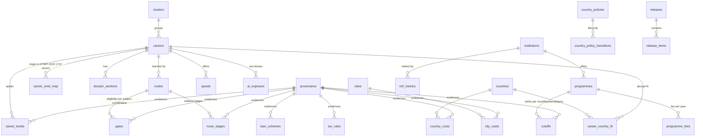
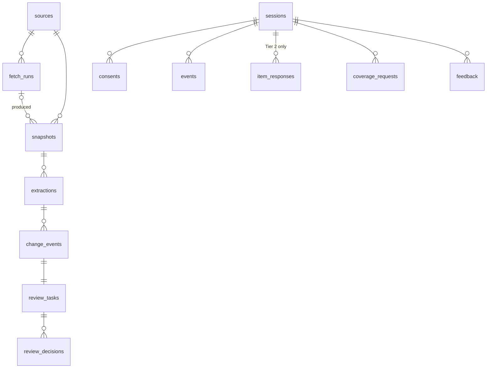

# Data model

Source of truth: SQL in `services/supabase/migrations/` and Zod schemas in
`packages/contracts/src/`. Constraints are duplicated deliberately: the
contracts reject bad data on the phone, in the pipeline and in Edge
Functions; the database rejects it again (05 §9 release gate, RULES.md
rule 2). DB tests: `services/supabase/tests/sql/`.

## ERD — content

## ERD — pipeline and telemetry

`telemetry.deletion_requests` has no foreign key on purpose: the audit row
survives the deletion it requested. `telemetry.settings` holds the minors
kill switch.

## Key invariants (DB-enforced)

| Rule                                                                                   | Where                                          |
| -------------------------------------------------------------------------------------- | ---------------------------------------------- |
| Sourced fact ⇒ `https` URL + non-blank quote + snapshot id                             | `provenance_sourced_evidence`                  |
| Assumption ⇒ non-blank rationale                                                       | `provenance_assumption_rationale`              |
| No forbidden source domains                                                            | `provenance_not_forbidden_source`              |
| `valid_to ≥ as_of`                                                                     | `provenance_valid_to_after_as_of`              |
| Gates and cutoffs need **sourced** provenance                                          | trigger `require_sourced_provenance`           |
| Ranges `low ≤ likely ≤ high`; percentiles `p10 ≤ p50 ≤ p90`; ranks `opening ≤ closing` | table checks                                   |
| Loan rates are ratios in [0, 0.5]                                                      | `loan_schemes_rate_range`                      |
| "Not reported" is NULL with no provenance, never 0                                     | `*_reported_has_source` checks                 |
| O*NET OI vector is all-or-nothing, 1–7, with provenance                                | `career_onet_vector_complete`                  |
| Programme registry key `institution + normalised code + campus (+ year)`               | unique constraint                              |
| LLM extraction confidence ≤ medium                                                     | `extractions_llm_confidence`                   |
| Edit/reject decisions need a note; edit needs a value                                  | `review_decisions_*`                           |
| One current release                                                                    | partial unique index `releases_single_current` |
| Tier 2 consent ⇒ teen assent                                                           | `consents_tier2_assent`                        |
| Exactly 60 item values, each 0–4                                                       | `item_responses_sixty`, `item_responses_range` |

## Row-level security

Every table in `content`, `pipeline`, `telemetry` has RLS **enabled and
forced**; a DB test fails if any table lacks it. Client roles have no default
grants (baseline migration).

| Schema    | anon | authenticated non-member | Studio viewer | Stream reviewer              | Owner                                    | service_role  |
| --------- | ---- | ------------------------ | ------------- | ---------------------------- | ---------------------------------------- | ------------- |
| content   | ✗    | ✗ (0 rows)               | read          | read                         | read                                     | read/write    |
| pipeline  | ✗    | ✗ (0 rows)               | read          | read + decide on own streams | read + decide on all                     | read/write    |
| telemetry | ✗    | ✗                        | ✗             | ✗                            | ✗ (aggregates via Studio views, Phase 8) | insert/delete |

Decisions are inserted with `reviewer = auth.uid()` (no impersonation), only
on pending tasks, one per person per task. A trigger sets the task status per
05 §8: critical needs the stream reviewer **and** the owner, any rejection is
final, low severity is owner-only (D-035). Reviewers never need UPDATE on
`review_tasks`. Helpers live in `private` (security definer,
`search_path = ''`) and are called as `(select private.fn())`.
